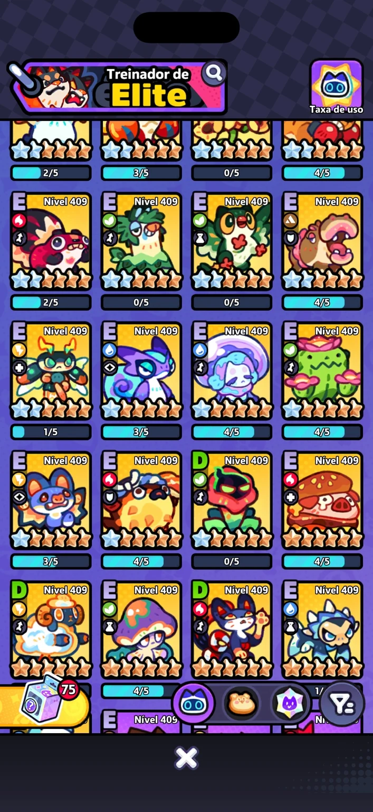
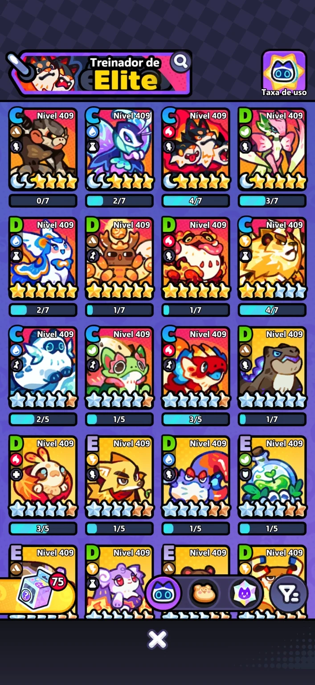
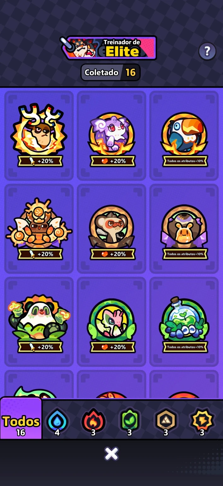
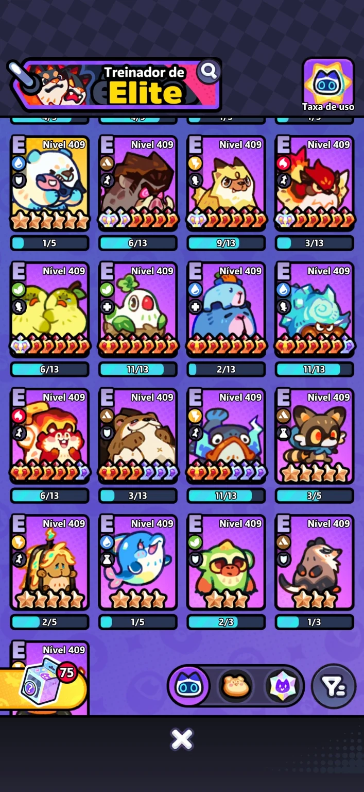
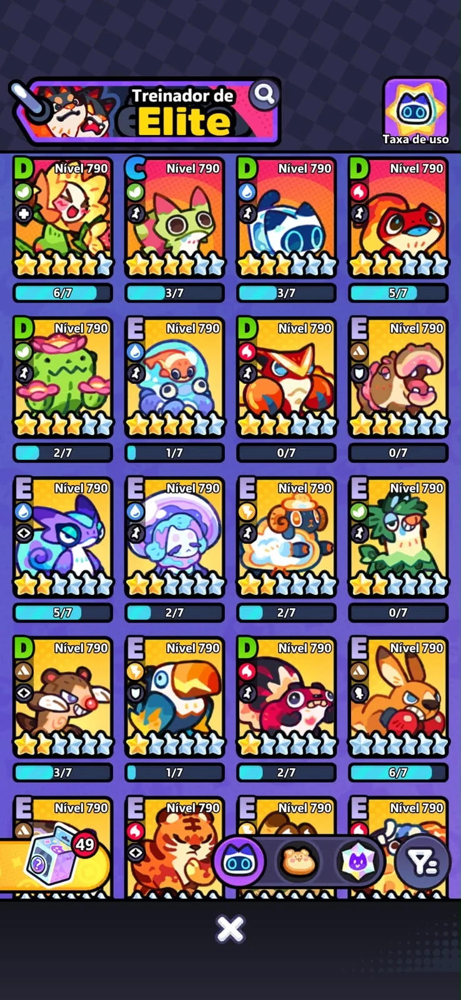
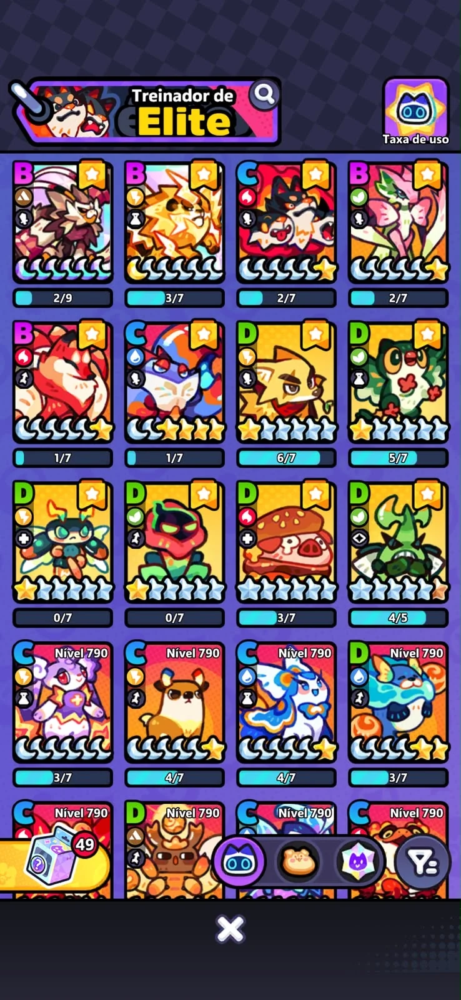
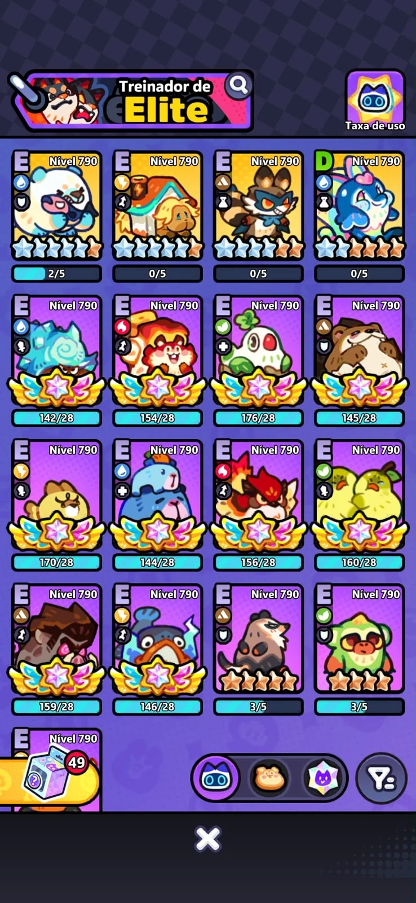
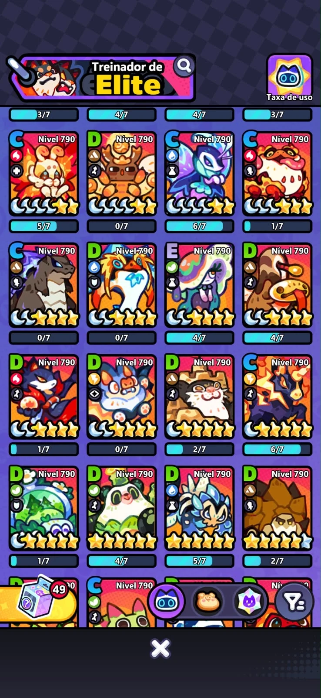

# Evoluções e progressão da conta

Compare o elenco que você tem com a função que deseja melhorar. Nível, evolução, estrelas e alimentação são dimensões diferentes: um personagem disponível no catálogo pode ainda não estar pronto para substituir outro na sua equipe.

## Roteiro do Alberto: do T2 aos primeiros T3 { #roteiro-alberto }

**Contribuição de Alberto · UID 30230499**

Este roteiro prioriza **campanha e Dojo**, objetivos escolhidos por Alberto para avançar e conseguir mais recursos. A ideia é organizar primeiro as opções no T2 e, depois, começar a formar um grupo de T3 de cada elemento.

<ol>
<li><strong>Organize o elenco no T2.</strong>Distribua as opções entre os elementos para atender à campanha e aos Dojos.</li>
<li><strong>Comece com um T3 de cada elemento.</strong>Use as prioridades abaixo e dê preferência ao Tatari que estiver mais perto de evoluir no seu elenco.</li>
<li><strong>Complete três opções T3 por elemento.</strong>Depois das primeiras prioridades, amplie os trios sugeridos conforme as evoluções ficarem ao seu alcance.</li>
</ol>

### Quem priorizar por elemento

Na Água, Alberto destaca **Gotinha e Borboleta** como primeiras opções. Nos demais elementos, suas escolhas iniciais são **Azulito, Mantis, Macaco e Leão**.

<section class="evolution-choice" aria-labelledby="evolution-agua" style="--evolution-element: #7cc9ec">
<h3 id="evolution-agua"><svg viewBox="0 0 32 32" aria-hidden="true" focusable="false"><path d="M16 2C12 8 6 14 6 20a10 10 0 0 0 20 0C26 14 20 8 16 2Z"/></svg>Água</h3>

Prioridade inicial para T3<strong>Gotinha e Borboleta</strong>

<strong>Trio sugerido:</strong> Borboleta, Gotinha e Glaciático.

Borboleta e Gotinha são os destaques do Alberto para diferentes partes do jogo. A linha de Geligato entra como opção econômica.

Geligato é T2; a meta T3 dessa linha é Glaciático.

</section>

<section class="evolution-choice" aria-labelledby="evolution-fogo" style="--evolution-element: #f4a078">
<h3 id="evolution-fogo"><svg viewBox="0 0 32 32" aria-hidden="true" focusable="false"><path d="M17 2c2 6-2 8-2 12-2-1-3-4-3-6C8 12 5 16 5 21a11 11 0 0 0 22 0c0-7-4-10-6-12 0 4-1 5-3 7 0-5 2-9-1-14Z"/></svg>Fogo</h3>

Prioridade inicial para T3<strong>Azulito</strong>

<strong>Trio sugerido:</strong> Mariposa, Azulito e Sapo ou Cerberus.

Mariposa e Azulito aparecem nas opções de campanha citadas por Alberto. Sapo ou Cerberus completa o trio e também pode ser aproveitado na Horda.

Escolha Sapo ou Cerberus para o terceiro espaço.

</section>

<section class="evolution-choice" aria-labelledby="evolution-planta" style="--evolution-element: #9bda9a">
<h3 id="evolution-planta"><svg viewBox="0 0 32 32" aria-hidden="true" focusable="false"><path d="M28 4C12 4 5 8 5 19a9 9 0 0 0 9 9C25 28 28 20 28 4Z"/><path d="M7 26c5-7 10-11 17-15" fill="none" stroke="var(--wiki-surface)" stroke-width="2"/></svg>Planta</h3>

Prioridade inicial para T3<strong>Mantis</strong>

<strong>Trio sugerido:</strong> Frutisapo, Mantis e Solaflora.

Mantis é a principal prioridade de Planta nessa recomendação. Frutisapo e a linha de Florinha completam as opções do elemento.

Florinha T1 → Girassólica T2 → Solaflora T3 → Heliaflor T4.

</section>

<section class="evolution-choice" aria-labelledby="evolution-pedra" style="--evolution-element: #d4b68c">
<h3 id="evolution-pedra"><svg viewBox="0 0 32 32" aria-hidden="true" focusable="false"><path d="M10 4h12l8 12-7 12H9L2 16 10 4Z"/><path d="m10 4 6 12-7 12m13-24-6 12 7 12M2 16h28" fill="none" stroke="var(--wiki-surface)" stroke-width="1.5"/></svg>Pedra</h3>

Prioridade inicial para T3<strong>Macaco</strong>

<strong>Trio sugerido:</strong> Macaco, Tartaruga e Cobra.

Alberto destaca o investimento no Macaco, a economia da Tartaruga e a capacidade da Cobra de lidar com uma linha de inimigos na campanha.

Use a proximidade da evolução para decidir qual completar em seguida.

</section>

<section class="evolution-choice" aria-labelledby="evolution-eletrico" style="--evolution-element: #f2cf74">
<h3 id="evolution-eletrico"><svg viewBox="0 0 32 32" aria-hidden="true" focusable="false"><path d="M18 2 6 18h9l-2 12 13-17h-9l1-11Z"/></svg>Elétrico</h3>

Prioridade inicial para T3<strong>Leão</strong>

<strong>Trio sugerido:</strong> Leão, Coelha e Cervo.

Leão é a primeira prioridade sugerida. Coelha e Cervo ampliam as opções para o elemento.

Morcego também entra nas opções, mas Alberto considera que ele funciona bem no T2 por um tempo.

</section>

### Como escolher a próxima evolução

Alberto recomenda **aproveitar quem já está mais perto de evoluir**. Comece pelas prioridades de cada elemento e, depois, complete os trios conforme os recursos e as provas do seu elenco permitirem.

Para organizar as metas, use o [Planejador de evoluções](../../../ferramentas/planejador-evolucoes.md). As funções de cada equipe podem ser consultadas em [Modo História](../../../formacoes/modo-historia.md), [Dojo](../../../formacoes/dojo.md) e [Horda](../../../formacoes/horda.md).

## O que comparar antes de investir

| Dimensão | O que observar | O que não concluir |
| --- | --- | --- |
| Nível | Nível da conta e nível mostrado no modo em questão | Que duas contas do mesmo nível tenham elencos equivalentes |
| Evolução T1–T4 | Nome da forma e descrição da habilidade | Que muitas estrelas signifiquem automaticamente T4 |
| Estrelas | Desenvolvimento dentro daquela família | Que o mesmo número de estrelas produza a mesma função em famílias diferentes |
| Alimentação | Classificação e atributos efetivamente melhorados | Que uma classificação agregada substitua a leitura dos atributos |
| Provas e insígnias | Requisitos exibidos para a evolução desejada | Que subir de nível complete automaticamente as provas |

[Entenda estrelas, alimentação e provas](../../../guias/tataris.md) · [Consulte as habilidades por família](../../../tataris.md)

!!! info "Dois exemplos reais, não uma média estatística"
    Registros recebidos em **09/11/2026**: conta 409 do mantenedor Mitchell e conta 790 de **DEODATO**, que cedeu as capturas. Os perfis abaixo são referências editoriais. Não estabelecem prazo, quantidade esperada de T4 ou progresso obrigatório por nível. A versão do aplicativo não aparece nas capturas.

## Exemplo: nível 409 — iniciante–intermediário

O inventário já apresenta diferentes evoluções, incluindo vários T3. Há investimento desigual entre famílias: classificações E/D em grande parte dos cartões e C em parte do grupo mais desenvolvido. A tela de insígnias mostra **16 no total: Água 4; Fogo 3; Grama 3; Pedra 3; Raio 3**.

**Leitura editorial:** esta conta não deve receber um guia limitado a T2. Faz mais sentido aproveitar os T3 disponíveis e identificar quais funções ainda faltam. As capturas não permitem certificar cada atributo, prova pendente ou eficiência em combate.

[{ loading=lazy }](../../../assets/progressao/conta-409-1.webp)

[{ loading=lazy }](../../../assets/progressao/conta-409-2.webp)

[{ loading=lazy }](../../../assets/progressao/conta-409-3.webp)

[{ loading=lazy }](../../../assets/progressao/conta-409-4.webp)

[{ loading=lazy }](../../../assets/progressao/insignias-409.webp)

*Fonte: capturas fornecidas por Mitchell. Abra uma imagem para consultar em tamanho maior.*

## Exemplo: nível 790 — intermediário–avançado

A coleção de **DEODATO** mostra maior desenvolvimento visível no grupo principal, com classificações B/C e mais estrelas, enquanto outras famílias permanecem D/E. Há diferentes estágios de evolução no mesmo inventário. Não contamos todos os T4 nem inferimos requisitos concluídos apenas pelos emblemas.

**Leitura editorial:** a progressão continua concentrada em algumas unidades; nível 790 não significa que todos os personagens estejam prontos para uma formação avançada. Comparar investimento e habilidade continua sendo necessário.

[{ loading=lazy }](../../../assets/progressao/deodato-790-1.webp)

[{ loading=lazy }](../../../assets/progressao/deodato-790-2.webp)

[{ loading=lazy }](../../../assets/progressao/deodato-790-3.webp)

[{ loading=lazy }](../../../assets/progressao/deodato-790-4.webp)

*Créditos: DEODATO — contribuição com capturas e dados da conta nível 790. As imagens documentam o inventário, não resultados de batalha.*

## Como usar as faixas 300, 700 e 1200+

Estas faixas organizam a leitura; **as recomendações são nossas, não uma curva média comprovada**. Escolha o perfil que corresponde ao seu elenco, mesmo que seu nível seja outro.

| Referência | Prioridade sugerida | Justificativa |
| --- | --- | --- |
| 300–400: elenco em consolidação | Desenvolver funções úteis com os personagens já investidos; aproveitar T3 disponíveis | O exemplo 409 já tem T3, mas investimento desigual. Não exige copiar uma equipe de T4 |
| Cerca de 700–800: núcleo mais desenvolvido | Comparar estrelas, alimentação e ganho da próxima evolução; fortalecer lacunas da formação | O exemplo 790 tem núcleo mais forte e unidades ainda pouco desenvolvidas |
| 1200+: exemplo ainda pendente | Avaliar cada personagem e confronto; não presumir estrelas máximas | Não recebemos uma conta dessa faixa. Nenhum inventário ou média foi inventado |

## Evoluir muda a função disponível

- **Manteeny → Stalkerix → Serrabloom → Orchitoria:** Serrabloom T3 já aplica Fragile; Orchitoria T4 acrescenta Grass Aura. Um T1/T2 não reproduz automaticamente essas funções.
- **Sackling → Jarachnid → Terracrawler → Weaverfang:** Jarachnid T2 e Terracrawler T3 possuem escudo próprio; a Grass Aura é da forma Weaverfang T4.
- **Dewgrub → Ripplewing → Waveflutter → Morphanessa:** Waveflutter T3 permite que aliados adjacentes apliquem Slow/Sleep. O patch de 21/10 esclarece que isso se aplica às habilidades normais, não às habilidades da Horda.

Fontes: fichas de [Manteeny](../../../tataris/manteeny.md), [Sackling](../../../tataris/sackling.md) e [Dewgrub](../../../tataris/dewgrub.md), com origens e limites da base; [patches oficiais transcritos](../../../patches-tataris.md). Os patches mais recentes sobre a mesma mecânica prevalecem sobre as descrições anteriores.

## Aplicação em diferentes modos

A progressão da conta é independente do modo de jogo. [Corrida do Ouro](../../../eventos/corrida-do-ouro.md) é um exemplo de aplicação: uma troca pode preservar o dano, mas perder escudo ou controle. Avalie também as exigências de [Dojo](../../../formacoes/dojo.md) e [Horda](../../../formacoes/horda.md).

Para ampliar os exemplos, contribua com nível, data, versão, coleção e insígnias. Não são necessários dados de acesso à conta. Capturas de requisitos ajudam mais que estimativas de gasto ou de tempo de jogo.
