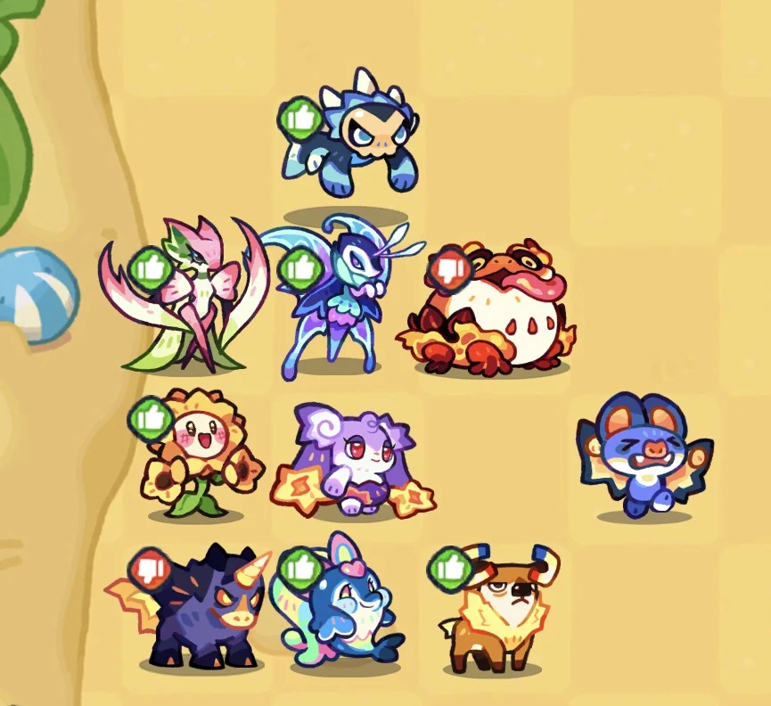

# Corrida do Ouro: regras e formações

Combine o objetivo do território com a liga e adapte a equipe ao seu elenco. Este guia reúne regras dos patches recebidos e estratégias comunitárias com origem identificada. Não existe aqui uma promessa de vitória ou uma formação universal.

[Ver exemplos reais de progressão: contas 409 e 790](../conteudo/tataria/guias/evolucoes.md)

!!! info "Como interpretar as fontes"
    Revisão editorial: **09/11/2026**. As transcrições oficiais mais recentes sobre a mesma mecânica prevalecem. Vídeo, relatos de suporte e bases comunitárias complementam os pontos não abordados pelos patches; não ganham status de regra oficial por repetição. As recomendações de adaptação são editoriais, sem teste próprio da wiki.

## Regras oficiais recebidas

O patch **04/11/2026 · 0.50.1.1150.6906** anuncia Lost City e Miragens: a liga com mais eliminações ao atacá-las recebe muitos pontos. Não fornece aqui coordenadas nem uma formação ideal.

- Desert Horn: líder, elites e vanguards podem usá-lo uma vez por dia; permissão a partir do dia seguinte à obtenção do título.
- Bebidas gratuitas: 50 por dia no Goldrush regular e no torneio; arena do torneio: cinco desafios diários.
- Rally: requisito de consumo de 1.000/3.000/5.000 bebidas conforme o grau.
- Liga: cinco elites, quinze vanguards e vinte mudanças de título por dia.
- Territórios mais próximos da base receberam maior defesa.
- Spa: dois efeitos rotativos semanais podem incluir menor consumo de bebidas ou maior chance de Glitter. Não assumir que ambos estejam ativos.

O patch de **21/10** limita caixas Goldrush a vinte resgates semanais por jogador. [Fonte e versões: anúncios oficiais transcritos pelo mantenedor](../patches-tataris.md). Não houve conferência autenticada independente da mensagem do Discord.

## Miragens: previsão não é localização garantida

Em [0:24–1:06 e 2:54–5:10 do vídeo](https://www.youtube.com/watch?v=Aqyh0IfeJL8&t=174s), Artiar explica que gravava no dia 2 e usa capturas do servidor de testes, cedidas por **Yoyo**, para antecipar os dias 3 e 5. As posições do dia 1 já haviam diferido no global.

Segundo essa previsão, os pontos do dia 5 se concentram perto das minas grandes, favorecendo o acesso pelo centro. Isso não garante controle nem vitória. **Mapas e coordenadas não foram reproduzidos:** as capturas do vídeo ainda não foram recebidas. Consulte as marcações da edição ativa.

## Formação do Artiar: adaptar ao investimento

Fonte: [explicação pessoal, 5:13–11:10](https://www.youtube.com/watch?v=Aqyh0IfeJL8&t=313s). O autor usa unidades mais desenvolvidas na própria conta e admite alternativas de DPS e tanque. Sua comparação maximizada começa em [11:11](https://www.youtube.com/watch?v=Aqyh0IfeJL8&t=671s); isso não equivale a uma conta de qualquer nível específico.

| Escolha descrita | Motivo | Limite da recomendação |
| --- | --- | --- |
| Louva-a-deus no lugar do macaco | Fragile e Grass Aura, com investimento semelhante na conta do autor | A aura pertence a Orchitoria T4; Serrabloom T3 fornece Fragile, não a mesma aura |
| Unicórnio no lugar da aranha | O unicórnio do autor estava mais desenvolvido | Não torna Boltallion um tanque por classificação nem obriga o jogador a investir nele |
| Aranha na comparação maximizada | Escudo próprio e, em Weaverfang T4, Grass Aura | Terracrawler T3 não oferece a aura do T4; requer condições para aplicar o escudo |
| Pinguim na comparação maximizada | Escudo próprio rápido; o autor cita 12% do HP do pinguim | Relato do teste, não escudo de 12% para toda a equipe nem recomendação de abandonar outra unidade investida |
| Hipopótamo como alternativa | Escudo após eliminar um inimigo | Pode receber mais dano antes de ativá-lo; depende do confronto |
| Caranguejo como alternativa | Aproveitar investimento e ajustar o posicionamento | O autor ter o personagem maximizado não estabelece requisito universal de estrelas máximas |

**Nomes corretos:** Mantis Tango é habilidade de Orchitoria; Tidal Shock é habilidade de Boltallion. Consulte as famílias [Manteeny](../tataris/manteeny.md), [Zapuni](../tataris/zapuni.md), [Sackling](../tataris/sackling.md), [Waddledo](../tataris/waddledo.md) e [Momopo](../tataris/momopo.md). As fichas preservam a origem comunitária das descrições e os limites de atualização.

### Invocações e dano contabilizado

Artiar relata que, após consultar o atendimento do jogo, recebeu a informação de que dano nos clones do macaco e nos cristais do caracol também entra na contabilização de dano/HP perdido. Essa é sua justificativa para retirá-los daquela composição. Ele ainda admite usar o macaco quando o investimento compensar.

**Ressalva:** não temos a resposta original do suporte nem um patch recebido confirmando esse cálculo. Não transformamos esse relato em “nunca use invocações”. Os cristais do caracol não devem ser chamados de cristais de gelo. [Fonte: 5:50–7:02](https://www.youtube.com/watch?v=Aqyh0IfeJL8&t=350s).

## Variante CN: uma opção recente para experimentar

[Artiar apresenta em 13:20–17:31](https://www.youtube.com/watch?v=Aqyh0IfeJL8&t=800s) uma composição de um criador chinês que busca deslocar a borboleta adversária e interromper sua interação com atacantes de longo alcance. Combina resistência, escudos e pressão de Fogo contra a frente inimiga. O exemplo mantém macaco e caranguejo, reforçando que não há proibição universal dessas unidades.

É uma **opção recente demonstrada contra a composição do vídeo**, enquanto acompanhamos a evolução do meta. O autor relata menor consumo de bebidas naquele confronto, não superioridade contra qualquer adversário. A interação do cogumelo com Sleep é situacional; não constitui uma proibição geral do personagem.

**Créditos:** estratégia de um criador da comunidade chinesa, apresentada por Artiar. O nome é exibido em torno de **13:20–13:30**, mas não consta na transcrição recebida. A identificação está pendente; não atribuímos a autoria original a Artiar nem inventamos o nome. Ainda não reproduzimos o tabuleiro original.

### Exemplo comunitário: adaptação na conta 409

Mitchell informa que utiliza uma adaptação CN. A captura abaixo mostra os **15 personagens posicionados**, sem comprovar resultado de batalha ou reprodução exata da composição chinesa.

[{ loading=lazy .formation-capture }](../assets/progressao/formacao-cn-409.webp)

*Captura cedida por Mitchell em 09/11/2026. Conta nível 409; os cartões da tela de formação exibem nível 500. A causa dessa diferença não foi confirmada. Não há relatório de batalha associado. Abra a imagem para ampliar.*

## Alternativas conforme o elenco

As faixas abaixo ajudam a localizar o perfil; não são médias comprovadas. Veja o [guia independente de Evoluções](../conteudo/tataria/guias/evolucoes.md) para os inventários reais.

| Perfil de referência | Possibilidades a comparar | Justificativa editorial |
| --- | --- | --- |
| Cerca de 300–400, incluindo o exemplo 409 | Jarachnid T2 ou Terracrawler T3 para escudo próprio; Serrabloom T3 para Fragile; Hellhound T3 para Weak, se já disponíveis | Aproveitar funções existentes sem exigir T4. T1/T2 da mesma família não garantem a habilidade desejada |
| Cerca de 700–800, incluindo o inventário de DEODATO 790 | Consolidar Fragile/Weak; Waveflutter T3 para controle de aliados adjacentes; Stoodbeak T3 como candidato a tanque com escudo próprio | Comparar sobrevivência e utilidade dos suportes com o atacante que sairia. Não equiparar Stoodbeak ao Glideflip maximizado do vídeo |
| 1200+, ainda sem conta de referência | Comparar Weaverfang, Orchitoria e Glideflip T4 com unidades já investidas; manter Boltallion, Cribking ou macaco se o confronto justificar | Nível alto não implica estrelas máximas. As condições do teste do autor importam mais que copiar a lista |

Fontes das funções: famílias [Pyropup](../tataris/pyropup.md), [Dewgrub](../tataris/dewgrub.md), [Manteeny](../tataris/manteeny.md), [Sackling](../tataris/sackling.md) e [Waddledo](../tataris/waddledo.md). O patch de 21/10 restringe o efeito da borboleta nas habilidades dos aliados às habilidades normais; não aplicar habilidades específicas da Horda ao Goldrush.

## Recursos: informações complementares

Estas informações **não são atribuídas ao vídeo**. A [wiki.gg — Island Gold Rush](https://clashofcritters.wiki.gg/wiki/Island_Gold_Rush), consultada em 09/11/2026, registra:

- **Tired:** custo crescente após faixas de ataques diários, começando após dez ataques. Distribuir ataques pode reduzir a fadiga, mas é preciso considerar objetivos e horários do evento. Confira o custo exibido, o bônus de ataque e os efeitos ativos; não trate dez bebidas como mínimo universal após descontos.
- **Produção:** Gold Vein em 1.800 ouro/hora e terreno pequeno em 60 ouro/hora, razão de trinta vezes por hora, não recompensa instantânea. São valores da tabela comunitária; confirme mapa e edição.
- **Fechamento diário:** a tabela descreve recompensas de terrenos específicos com caixas. Isso não comprova bônus genérico de ouro por toda posse no reset, nem justifica atacar sempre nos últimos minutos.

O [Tatari Companion — Goldrush](https://kenzkunz.github.io/tatari-companion/events/island-goldrush.html) descreve consumo associado ao dano acumulado em relação ao HP máximo da batalha: cura não apaga dano já registrado. Trata-se de explicação comunitária, não de fórmula oficial conferida pela wiki. Dano, resultado da batalha e pontos de liga não são a mesma medida.

### O que permanece sem confirmação suficiente

Não recomendamos concentrar Glitter Fruits por uma suposta redução de chance ao dividir, nem fixamos taxa atual ou garantia de Glitter. Também não publicamos regra de trocar a defesa ao desconectar. Esses pontos exigem fontes próprias. O patch de novembro confirma a possibilidade de buff semanal de Glitter, mas não fornece aqui a probabilidade numérica.

## Fontes, créditos e próximos registros

- **Artiar:** [vídeo original](https://www.youtube.com/watch?v=Aqyh0IfeJL8), análise baseada na transcrição fornecida pelo mantenedor; não houve inspeção integral das imagens do vídeo. A autoria do exemplo CN é de outro criador, ainda por identificar.
- **Yoyo:** capturas do servidor de testes mencionadas pelo autor; não reproduzidas nesta página.
- **Mitchell:** captura da adaptação CN e exemplo de conta 409.
- **DEODATO:** inventário da conta 790 no guia de Evoluções; não é autor da formação CN e não forneceu relatório de Goldrush nesta contribuição.
- **Wiki.gg e Tatari Companion:** fontes complementares identificadas junto das afirmações. Os textos desta página são sínteses e adaptações comunitárias; preservam-se os créditos e a [licença dos textos derivados da wiki.gg](https://clashofcritters.wiki.gg/wiki/Clash_of_Critters_Wiki:Copyrights), CC BY-SA 4.0, conforme a política já usada no catálogo. Artes e interface pertencem aos respectivos titulares.

Para reproduzir o exemplo original faltam capturas em 5:13, 11:11 e 14:24 e o crédito CN em 13:20. Resultados comparáveis devem informar adversário, bônus selecionado, fadiga, bebidas consumidas e formação; não é necessário gastar recursos só para enviar um registro.
