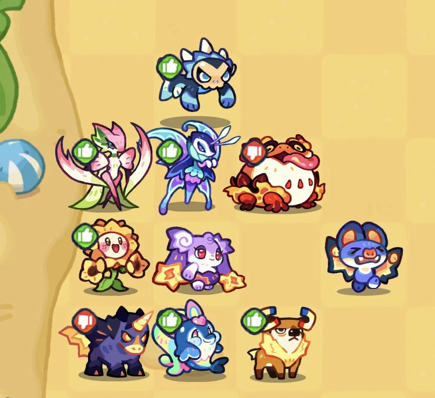

# Guia de Invasão de Hordas: Dificuldade 3

## Estratégia do Duplo Tubarão

> **Créditos da criação original:** Migby  
> Traduzido e adaptado para a Wiki PT-BR do Clash of Critters.

## 1. Visão geral e fator sorte (RNG)

A conclusão da Dificuldade 3 na Invasão de Hordas exige controle de mapa, gerenciamento preciso de níveis e paciência com o fator sorte nos **Chips**.

- **Fator sorte (RNG):** é normal precisar tentar a partida várias vezes. A oferta dos chips certos dita o sucesso da run.
- **Mecânica principal (Duplo Tubarão):** a estratégia usa dois Tubarões de Água, um para cada jogador. Em vez de tentar matar chefes com HP muito alto, o Tubarão é usado para arrastá-los para fora do mapa, eliminando-os ao custo de 1 vida da base (de um total de 10).
- **Chip core (Cortador de Grama / Lawn Mower):** é extremamente útil para limpar automaticamente os Zobos pequenos que passam enquanto a equipe está focada em puxar os chefes.

## 2. Formação da equipe e posicionamento

A composição da linha de frente é idêntica para os dois jogadores. A variação ocorre nas unidades de suporte e DPS da retaguarda.

```text
       [ Linha de Frente (Topo) ]
 ---------------------------------------
 |   Sapo   |   Mantis   | Polialeta   |  <-- Linha Central Defensiva
 ---------------------------------------
 |  Girasol |   Morcego  |   Nimeta    |  <-- Linha Intermediária
 ---------------------------------------
 |             Variações               |  <-- Retaguarda (Ajustável)
 ---------------------------------------
```

{ .formation-capture loading="lazy" }

*Imagem de referência da formação enviada pelo mantenedor. Os ícones de aprovação/reprovação fazem parte da captura e não representam uma classificação editorial da wiki.*

### Posicionamento por jogador (10 Tataris)

- **Linha de frente (inamovível):** Sapo, Mantis e Polialeta no topo.
- **Linha central:** Girasol (esquerda/muro), Morcego (*Bat*) e Nimeta.
- **Tubarão:** posicione-o na linha mais avançada permitida pelo mapa para puxar os inimigos assim que surgirem.

### Distribuição da retaguarda (DPS e suporte)

- **Jogador 1 (controle e perfuração):** Zapaller (colado na parede), Raposa e Golfinho.
- **Jogador 2 (dano em área e burst):** Zapaller, Unicórnio e Aletur.

> **Nota:** apenas um dos jogadores precisa carregar o Golfinho. Os DPS de retaguarda servem exclusivamente para conter as ondas de Zobos pequenos e evitar vazamentos de vida.

## 3. Tabela rígida de níveis dos Tataris

> ⚠️ **Atenção:** nível mais alto nem sempre é melhor. Evite Atordoamento (*Stun*) a todo custo. Atordoar chefes grandes, como o Franken-Peixe, impede que o Tubarão consiga arrastá-los a tempo antes de o cronômetro expirar.

| Tatari | Nível-alvo | Motivo / regra de ouro |
| :--- | :---: | :--- |
| **Girasol** | **Nível 3 ou 4** | ❌ Nunca suba para o nível 5 ou 7: o nível 5/7 adiciona atordoamento e estraga a puxada do Tubarão. |
| **Tubarão** | **Nível 5 ou 6** | ⚡ Nível 5 obrigatório pelo escudo. ❌ Nunca suba para o nível 7, que adiciona atordoamento. |
| **Nimeta** | **Nível 3 ou 5** | Nível 5 concede invencibilidade. ❌ Nunca suba para o nível 7, que aplica atordoamento. |
| **Golfinho** | **Nível 5** | Concede o debuff *Fragile*. ❌ Nunca suba para o nível 7, que aplica atordoamento. |
| **Sapo** | **Nível 7** | Dano em área massivo; prioridade alta. |
| **Mantis** | **Nível 7** | O atordoamento do nível 7 é aplicado nela mesma, não nos inimigos. Seguro para maximizar. |
| **Polialeta** | **Nível 7** | Dano bruto e sustentação. |
| **Aletur** | **Nível 7** | DPS principal em área para Zobos pequenos. |
| **Unicórnio** | **Nível 7** | Dano e suporte de campo. |
| **Zapaller** | **Nível 7** | Dano perfurante em linha reta. |
| **Morcego** | **Nível 3** | Nível 3 é o mínimo funcional. Suba para o 7 apenas se sobrarem doces. |

### Dica de economia de doces

> **Recomendação comunitária, não regra oficial:** no início da partida, suba todos os Tataris disponíveis para essa formação apenas até o **nível 2** e pare os investimentos. Aguarde a escolha do **segundo chip** antes de maximizar os níveis. Se aparecer um chip de economia ou redução de custo de doces, escolha-o primeiro e só então use os doces restantes para seguir a tabela acima. Se o segundo chip não trouxer economia, retome a evolução de acordo com a prioridade da composição e com o desempenho da sua faixa.

Essa abordagem preserva doces para uma possível economia, mas pode reduzir o dano inicial. Se a linha estiver vazando antes do segundo chip, priorize a unidade necessária para estabilizar a rodada em vez de seguir a regra de forma cega.

## 4. Gestão de chefes: quem puxar e quem matar

A base possui **10 vidas**. A estratégia utiliza exatamente 5 vidas para eliminar os chefes mais perigosos via Tubarão. Os demais chefes devem ser mortos com dano direto.

### Chefes para arrastar (usar Tubarão; gastar 5 vidas)

1. **Zobo Vulcânico (onda 20):** HP extremamente alto; demora demais para morrer com dano convencional.
2. **Zobo Marinheiro (onda 20):** lança barris que causam dano em área devastador na linha de frente; deve ser puxado imediatamente após o Vulcânico.
3. **Zobo Peixe-Bagre (onda 25):** movimenta-se em zigue-zague; se não for puxado, o tempo da rodada acaba.
4. **Zobo Estrela do Pop (onda 25):** invoca Zobos pequenos; se chegar perto da base e invocar minions, pode tirar até 3 vidas de uma só vez.
5. **Zobo Jardinheiro (onda 25):** prende unidades em raízes; se prender o Tubarão, a estratégia inteira falha.

### Chefes para matar com dano direto

- **Faraó:** HP moderado; morre facilmente para a retaguarda.
- **Cavaleiro:** pouco risco mecânico; pode ser eliminado com DPS concentrado.
- **Yeti / chefes de Planta:** eliminados com o dano concentrado da linha de frente.

## 5. Como executar a puxada com o Tubarão

1. **Primeira puxada:** posicione o Tubarão uma casa à frente da linha principal de defesa e puxe o chefe.
2. **Segunda puxada:** recue o Tubarão para a segunda linha, substituindo temporariamente a casa da Nimeta, e puxe o chefe novamente.
3. **Terceira puxada:** recue o Tubarão duas casas para trás para o puxão final.
4. **Liberação:** avance o Tubarão de volta para a frente para deixar o chefe caminhar diretamente para a base, consumindo 1 vida e limpando a rota.

## 6. Prioridade de chips

### Tier S (essenciais)

- **Cortador de Grama (Lawn Mower):** limpa os minions automaticamente enquanto os chefes são movidos.
- **Patch de Atualização (Upgrade Patch):** ganho direto de atributos e utilidade.
- **Glass Cannon:** aumento massivo de dano para a retaguarda.

### Tier A (recomendados)

- **Geradores de Doces:** aceleram os níveis dos DPS. Evite chips que sobem diretamente para o nível 8 para não desperdiçar doces.
- **Barricada:** retém o avanço e protege a linha defensiva.
- **Underdog (Ganhador Inesperado):** bom contra-ataque elemental.
- **Boosts elementais:** Elétrico, Água e Fogo.
- **Matador de Chefes (Boss Slayer):** aumenta o dano contra chefes que precisam ser mortos com dano direto.

### Tier F (evitar)

- ❌ **Foco Central (Central Focus):** desorganiza o posicionamento e expõe a base.
- ❌ **Justiceiro / Equalizer (Equilibrador):** rebaixa todos os Tataris para o nível 4, destruindo Tataris de nível 7.
- ❌ **Chip Prismático aleatório no fim da partida:** há risco de sortear o *Equalizer* e perder a partida.

## Observação de versão

Este guia é uma estratégia comunitária atribuída a Migby. A Temporada 3 recebeu rebalanceamentos oficiais nas dificuldades 1–4 e novos inimigos; confira a descrição dos chips e as habilidades na interface da versão atual antes de reproduzir a formação.

[Ver as notas de patch da Horda](../patches-tataris.md)
