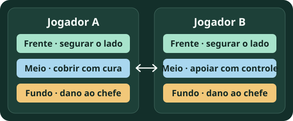

# Invasão da Horda

Na Invasão da Horda, dois jogadores defendem o tabuleiro contra ondas de Zobos. Durante a partida, a dupla posiciona Tataris, melhora unidades e escolhe chips.

**Revisão em 08/11/2026.** As mudanças abaixo seguem as transcrições oficiais de **21/10 (0.49.1.4372.6766)** e **04/11 (0.50.1.1150.6906)** fornecidas pelo mantenedor. As versões 0.50.1/0.51.1 citadas anteriormente não foram reconciliadas entre as fontes. [Consultar patches e origem](../patches-tataris.md#referencias-recebidas).

## O que mudou na Temporada 3

O anúncio de **21/10/2026 · 0.49.1.4372.6766** abriu a Temporada 3. Ela acrescentou **D5 e D6**, rebalanceou **D1 a D4**, zerou o ranking sazonal e mudou os inimigos e a ordem de alguns chefes. A dificuldade inicial da temporada ficou um nível abaixo da maior alcançada na Temporada 2.

| O que mudou | Como afeta a leitura dos guias |
| --- | --- |
| Dificuldade e inimigos | Compare a dificuldade e a ordem dos chefes antes de usar uma formação de outra temporada. |
| Chips | O patch de 21/10 alterou AFK de 300 para 400 energizadores, First-Aid Kit de 15% para 12% de HP recuperado, Lawn Care de 40% para 35% de dano baseado no HP máximo e Mission Reset de 200 para 180 energizadores. Confira os nomes e os efeitos na interface do jogo. |
| Habilidades de Tataris | O patch de 21/10 manteve a aplicação de lentidão e sono de Waveflutter e Morphanessa nas habilidades regulares dos aliados adjacentes. As habilidades exclusivas da Horda desses aliados deixaram de receber esse efeito. |
| Patch de 04/11 · 0.50.1.1150.6906 | A Farlight anunciou habilidades da Horda para Wattail e suas evoluções, melhorias de desempenho e avisos quando um Tatari fica impedido de se mover. |

[Transcrições oficiais e limites de verificação](../patches-tataris.md)

!!! info "Prévia da próxima temporada"
    Uma [demonstração do servidor pioneiro](../previas/roost.md) apresenta Roost e chips ligados à Horda S4. Os efeitos ainda podem mudar; este guia continua descrevendo a Temporada 3 até a publicação do patch oficial.

## Referências da Temporada 3

Estas referências foram publicadas no início da Temporada 3, antes do anúncio de 04/11. As sugestões abaixo servem para escolher o que testar. Ainda faltam nesta wiki partidas com formação, resultado e versão do anúncio de 04/11 documentados.

| Referência | O que consultar |
| --- | --- |
| [Critter Clashbook · funções dos Tataris na Temporada 3](https://clashcritters.com/tier-list/horde-invasion/) · 27/10/2026 | Opções para segurar a frente, curar e lidar com chefes. O guia usa os nomes em inglês. |
| [r/ClashofCritters · proposta de formação D3/D4 com crédito a Artiar](https://www.reddit.com/r/ClashofCritters/comments/1xcpq2e/new_d3_d4_meta_horde_formation/) · 22/10/2026 | Imagem da formação sugerida e discussão de substituições. A postagem é uma proposta de teste. |

[Consultar a tier list por função na Horda](../guias/tier-list.md#horda-temporada-3)

[Abrir o guia comunitário da Dificuldade 3 (Duplo Tubarão)](horda-d3.md){ .md-button }

## O que combinar com a dupla

{ .wiki-diagram loading="lazy" }

*Exemplo de divisão de tarefas. Ajustem as posições de acordo com a faixa onde a rodada está travando.*

| Quando | O que decidir |
| --- | --- |
| Antes de entrar | Qual lado cada um cobre, quem segura a frente e quem cuida da cura, do controle e do dano aos chefes. |
| Ao escolher chips | Qual efeito resolve o problema da rodada. Confiram a descrição exibida antes de basear a estratégia em um valor de guia antigo. |
| Ao melhorar unidades | Se a frente cai cedo, reforcem aquela faixa. Se a frente aguenta mas o chefe sobrevive, concentrem dano e alcance na faixa dele. |
| Depois da rodada | Guardem o resultado e anotem onde a formação travou. Testem uma mudança por tentativa para conseguir comparar. |

**Grau e nível da partida são informações diferentes.** T2 e T3 indicam evolução. Registre à parte os níveis atingidos durante a Horda.

## Arquivo de temporadas anteriores

As publicações abaixo mostram estratégias de versões anteriores, com condições que podem ter mudado. Consulte o número de ondas, os inimigos e os chips na sua partida antes de usar o arquivo.

- **D2 em setembro de 2026.** [FishingRare9172 registrou uma conclusão e a formação usada](https://www.reddit.com/r/ClashofCritters/comments/1w95inu/finally_got_through_difficulty_2_of_horde/).
- **D3 em setembro de 2026.** [iMarco descreveu uma formação e como dividiu os lados](https://www.reddit.com/r/ClashofCritters/comments/1wgwleg/d3_horde_guide_setup_general_strategy_thread/).
- **Temporada 1, D3.** [Critter Clashbook comparou tentativas com 749–750 eliminações](https://www.clashcritters.com/guides/horde-invasion-meta-guide/).
- **Formato de 35 ondas.** [Critter Clashbook registrou 1.014 eliminações com Sizzribb T2](https://clashcritters.com/guides/horde-1014-t2-sizzribb-formation/).

## Testes da comunidade BR

Para registrar uma partida, envie a versão do jogo, a temporada, a dificuldade, a formação dos dois jogadores e o resultado. A captura do relatório ajuda a ligar a estratégia à edição em que ela foi usada.

[Ver modelo para registrar uma partida da Horda](../colabore.md#modelo-de-partida-da-horda){ .md-button }
