# Tier list de Tataris

Escolha a lista de acordo com o seu objetivo. A lista de iniciantes considera a primeira forma (T1). A da Horda mostra as formas T3 selecionadas e o papel de cada uma na dupla. **As letras S, A e B indicam prioridade de escolha. T1 a T4 indicam grau de evolução.**

[Ver a lista de iniciantes](#campanha-inicial-t1){ .md-button }
[Ver a lista da Horda](#horda-temporada-3){ .md-button }

## Campanha inicial · T1

Seleção do ranking de iniciantes do Critter Clashbook, revisado pela fonte em 03/11/2026. Use os nomes em inglês para localizar as fichas na fonte.

### S · Prioridade para começar

- 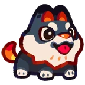{ .wiki-tatari-portrait loading="lazy" width="72" height="72" } **[Pyropup](pyropup.md)** T1 
  Frente de Fogo
- 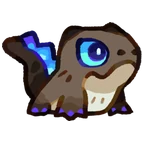{ .wiki-tatari-portrait loading="lazy" width="72" height="72" } **Rubblet** T1 
  Frente de Pedra
- { .wiki-tatari-portrait loading="lazy" width="72" height="72" } **Blueflick** T1 
  Dano de Fogo
- 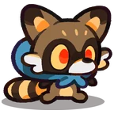{ .wiki-tatari-portrait loading="lazy" width="72" height="72" } **Ringtail** T1 
  Apoio aos aliados próximos

### A · Boas alternativas iniciais

- 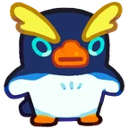{ .wiki-tatari-portrait loading="lazy" width="72" height="72" } **Waddledo** T1 
  Frente de Água
- 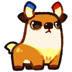{ .wiki-tatari-portrait loading="lazy" width="72" height="72" } **Voltfawn** T1 
  Dano Elétrico
- 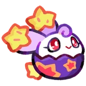{ .wiki-tatari-portrait loading="lazy" width="72" height="72" } **Cheerling** T1 
  Cura e bônus

### B · Opções para completar a equipe

- { .wiki-tatari-portrait loading="lazy" width="72" height="72" } **Droppit** T1 
  Dano de Água
- 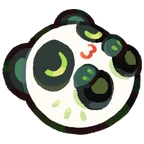{ .wiki-tatari-portrait loading="lazy" width="72" height="72" } **Pandaroo** T1 
  Dano de Planta
- 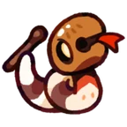{ .wiki-tatari-portrait loading="lazy" width="72" height="72" } **Taptail** T1 
  Dano de Pedra

## Horda · Temporada 3

A classificação abaixo é uma **seleção editorial da wiki**, baseada nas funções descritas pelo Critter Clashbook no início da Temporada 3 (27/10/2026) e nas notas da Farlight consultadas até a **0.51.1**. As letras priorizam o encaixe na função indicada. A lista fica como referência de teste até termos partidas documentadas nessa versão.

### S · Prioridade na função

- 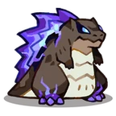{ .wiki-tatari-portrait loading="lazy" width="72" height="72" } **Rockzilla** T3 
  Frente de Pedra
- 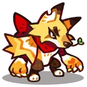{ .wiki-tatari-portrait loading="lazy" width="72" height="72" } **Voltverine** T3 
  Frente com dano Elétrico
- 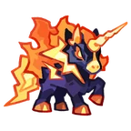{ .wiki-tatari-portrait loading="lazy" width="72" height="72" } **Voltmare** T3 
  Dano concentrado em chefes
- 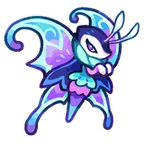{ .wiki-tatari-portrait loading="lazy" width="72" height="72" } **Waveflutter** T3 
  Dano para cobrir a faixa
- 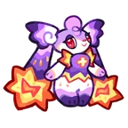{ .wiki-tatari-portrait loading="lazy" width="72" height="72" } **Cheerspring** T3 
  Cura e bônus para a equipe
- 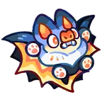{ .wiki-tatari-portrait loading="lazy" width="72" height="72" } **Sonarbat** T3 
  Suporte que depende da cobertura da dupla

### A · Alternativas fortes

- 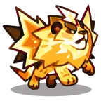{ .wiki-tatari-portrait loading="lazy" width="72" height="72" } **Blitzmane** T3 
  Estabilidade na frente
- 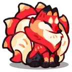{ .wiki-tatari-portrait loading="lazy" width="72" height="72" } **Flarevix** T3 
  Dano de Fogo na retaguarda
- 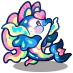{ .wiki-tatari-portrait loading="lazy" width="72" height="72" } **Aquariel** T3 
  Cura e bônus com ondas
- 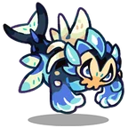{ .wiki-tatari-portrait loading="lazy" width="72" height="72" } **Armorjaw** T3 
  Puxa o chefe para a faixa de dano

### B · Escolhas situacionais

- 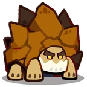{ .wiki-tatari-portrait loading="lazy" width="72" height="72" } **Rockshell** T3 
  Proteção na frente
- 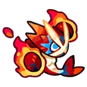{ .wiki-tatari-portrait loading="lazy" width="72" height="72" } **Pyroclobster** T3 
  Alternativa de dano de Fogo
- 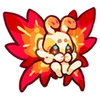{ .wiki-tatari-portrait loading="lazy" width="72" height="72" } **Charflutter** T3 
  Cura e bônus na mesma unidade
- 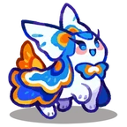{ .wiki-tatari-portrait loading="lazy" width="72" height="72" } **Tideon** T3 
  Lentidão e Fragile na retaguarda

**Ajuste da Temporada 3.** Na 0.50.1, os efeitos de lentidão e sono de Waveflutter e Morphanessa deixaram de se aplicar às habilidades exclusivas de Horda dos aliados adjacentes. As habilidades regulares desses aliados ainda podem receber o efeito. Confira a descrição no jogo ao testar essa combinação.

[Ver o diagrama da dupla no guia da Horda](../formacoes/horda.md#o-que-combinar-com-a-dupla)

## Fontes e créditos

Esta é uma wiki de fãs. Os retratos são artes da Farlight Games disponibilizadas no Creator Kit, com redimensionamento para esta página.

- [Critter Clashbook · Ranking por grau de evolução](https://clashcritters.com/tier-list/)
- [Critter Clashbook · Funções na Horda, Temporada 3](https://clashcritters.com/tier-list/horde-invasion/)
- [Farlight · Notas das versões 0.50.1 e 0.51.1](https://coc-club.farlightgames.com/)
- [Farlight · Creator Kit e créditos dos retratos](https://activity-cc.farlightgames.com/CreatorZone/#kit)
- [TataDex · Linhas de evolução dos Tataris](https://tatadex.org/evolutions/)
