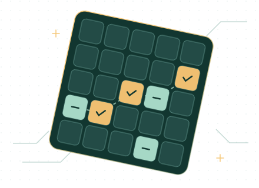

---
hide:
  - navigation
  - toc
---

<aside class="wiki-latest" aria-label="Última novidade da wiki" markdown="1">

<!-- ultima-novidade -->

[Ver todas as novidades →](novidades.md){ .wiki-latest-link }

</aside>

WIKI DA COMUNIDADE · PT-BR

# Clash of Critters BR

Guias para começar, consultar formações e aproveitar os eventos do jogo.

[Explorar formações](formacoes/index.md){ .md-button .md-button--primary .wiki-primary }
[Guia de iniciante](comece-aqui.md){ .md-button .wiki-secondary }

## Formações por modo

▦

### Modo História

Consulte a campanha por capítulo e fase, a partir do capítulo 1.

[Abrir Modo História →](formacoes/modo-historia.md)

◇

### Dojo

Entenda os duelos por elemento e as insígnias do Dojo.

[Abrir Dojo →](formacoes/dojo.md)

▰

### Horda

Veja como funcionam as ondas, a dupla e os chips da Horda.

[Abrir Horda →](formacoes/horda.md)

## Guias rápidos

### Comece aqui

Entenda o tabuleiro e saiba o que testar quando uma fase travar.

[Ver guia de iniciante →](comece-aqui.md) · [Consultar tier list →](guias/tier-list.md)

### Caça ao Tesouro

Configure o tabuleiro no solver e registre as escavações.

[Ver guia do evento →](eventos/caca-ao-tesouro.md) · [Ver outros eventos →](eventos/index.md)

**Passou com uma formação diferente?** Ajude a documentar os Tataris, os Tiers e o que você mudou.

[Veja como contribuir →](colabore.md) · [Veja o que mudou na wiki →](novidades.md)

