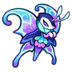

# Família Dewgrub
[← Catálogo](../tataris.md)

**Água · 4 formas cadastradas**

[Dewgrub · T1](#dewgrub) → [Ripplewing · T2](#ripplewing) → [Waveflutter · T3](#waveflutter) → [Morphanessa · T4](#morphanessa)

!!! info "Origem e revisão"
    Base da wiki.gg coletada em 09/10/2026 e preservada pelo Horde Drafter. As notas abaixo aplicam os patches fornecidos pelo mantenedor em 07/11/2026. Descrições traduzidas pela comunidade; nomes de habilidades e efeitos próprios foram preservados para facilitar a consulta no jogo. Valores de balanceamento não foram certificados para a temporada atual.

!!! note "Patch oficial fornecido"
    04/11: adicionadas sete aparências Sparkle à evolução T4 desta família.

!!! note "Patch oficial fornecido"
    21/10: habilidades da Horda receberam melhorias; os valores não foram publicados no texto do patch.

## Dewgrub · T1 {#dewgrub}

{ width=160 height=160 loading=lazy }

**Elemento:** Água · **Função:** Suporte · **Raridade:** Rara

### Habilidade normal

Drowsy Shot: Lança bombas de água que aplicam Lentidão e às vezes Sono.

Consultar descrição original em inglês

Drowsy Shot: Launches water bombs that inflict Slow and sometimes inflict Sleep.

### Horda: níveis da partida

Os níveis 3, 5 e 7 abaixo são melhorias durante a Horda, independentes do grau T1–T4.

- **Nível 3 — Aqua Flutter:** Os ataques têm chance de lançar 1 borboleta perfurante a partir da posição do alvo.
- **Nível 5 — Resonant Flutter:** Concede periodicamente a vários aliados o seguinte efeito: os ataques têm chance de lançar uma borboleta extra.
- **Nível 7 — Torrential Flutter:** Invoca várias borboletas aliadas. Libera uma névoa perfurante que causa dano, com chance de aplicar Sono.

[Página de origem e histórico de autores](https://clashofcritters.wiki.gg/wiki/Dewgrub)

## Ripplewing · T2 {#ripplewing}

{ width=160 height=160 loading=lazy }

**Elemento:** Água · **Função:** Suporte · **Raridade:** Rara

### Habilidade normal

Sleepy Shot: Lança bombas de água que aplicam Lentidão e às vezes Sono. Causa dano aos inimigos que despertam do Sono.

Consultar descrição original em inglês

Sleepy Shot: Launches water bombs that inflict Slow and sometimes inflict Sleep. Deals damage to enemies that wake from Sleep.

### Horda: níveis da partida

Os níveis 3, 5 e 7 abaixo são melhorias durante a Horda, independentes do grau T1–T4.

- **Nível 3 — Aqua Flutter:** Os ataques têm chance de lançar 1 borboleta perfurante a partir da posição do alvo.
- **Nível 5 — Resonant Flutter:** Concede periodicamente a vários aliados o seguinte efeito: os ataques têm chance de lançar uma borboleta extra.
- **Nível 7 — Torrential Flutter:** Invoca várias borboletas aliadas. Libera uma névoa perfurante que causa dano, com chance de aplicar Sono.

[Página de origem e histórico de autores](https://clashofcritters.wiki.gg/wiki/Ripplewing)

## Waveflutter · T3 {#waveflutter}

{ width=160 height=160 loading=lazy }

**Elemento:** Água · **Função:** Suporte · **Raridade:** Rara

### Habilidade normal

Somno-Shot: Lança bombas de água que aplicam Lentidão e às vezes Sono. As habilidades normais dos aliados adjacentes também podem aplicar Lentidão e Sono; as habilidades da Horda não recebem esse efeito (patch de 21/10/2026). Causa dano aos inimigos que despertam do Sono.

Consultar descrição original em inglês

Somno-Shot: Launches water bombs that inflict Slow and sometimes inflict Sleep. Attacks from adjacent allies can also inflict Slow and Sleep. Deals damage to enemies that wake from Sleep.

!!! warning "Correção de 21/10/2026"
    Somno-Shot (Waveflutter) e Rippling Shot (Morphanessa) permitem que habilidades normais dos aliados adjacentes apliquem Lentidão (Slow) e Sono (Sleep). Esse efeito não se aplica às habilidades da Horda.

### Horda: níveis da partida

Os níveis 3, 5 e 7 abaixo são melhorias durante a Horda, independentes do grau T1–T4.

- **Nível 3 — Aqua Flutter:** Os ataques têm chance de lançar 1 borboleta perfurante a partir da posição do alvo.
- **Nível 5 — Resonant Flutter:** Concede periodicamente a vários aliados o seguinte efeito: os ataques têm chance de lançar uma borboleta extra.
- **Nível 7 — Torrential Flutter:** Invoca várias borboletas aliadas. Libera uma névoa perfurante que causa dano, com chance de aplicar Sono.

[Página de origem e histórico de autores](https://clashofcritters.wiki.gg/wiki/Waveflutter)

## Morphanessa · T4 {#morphanessa}

{ width=160 height=160 loading=lazy }

**Elemento:** Água · **Função:** Suporte · **Raridade:** Rara

### Habilidade normal

Rippling Shot: Lança bombas de água que aplicam Lentidão e às vezes Sono. As habilidades normais dos aliados adjacentes também podem aplicar Lentidão e Sono; as habilidades da Horda não recebem esse efeito (patch de 21/10/2026). Causa dano aos inimigos que despertam do Sono. Morphanessa possui Aura: Water enquanto está no campo.

Consultar descrição original em inglês

Rippling Shot: Launches water bombs that inflict Slow and sometimes inflict Sleep. Attacks from adjacent allies can also inflict Slow and Sleep. Deals damage to enemies that wake from Sleep. Morphanessa carries Aura: Water whenever on the battlefield.

!!! warning "Correção de 21/10/2026"
    Somno-Shot (Waveflutter) e Rippling Shot (Morphanessa) permitem que habilidades normais dos aliados adjacentes apliquem Lentidão (Slow) e Sono (Sleep). Esse efeito não se aplica às habilidades da Horda.

### Horda: níveis da partida

Os níveis 3, 5 e 7 abaixo são melhorias durante a Horda, independentes do grau T1–T4.

- **Nível 3 — Aqua Flutter:** Os ataques têm chance de lançar 1 borboleta perfurante a partir da posição do alvo.
- **Nível 5 — Resonant Flutter:** Concede periodicamente a vários aliados o seguinte efeito: os ataques têm chance de lançar uma borboleta extra.
- **Nível 7 — Torrential Flutter:** Invoca várias borboletas aliadas. Libera uma névoa perfurante que causa dano, com chance de aplicar Sono.

[Página de origem e histórico de autores](https://clashofcritters.wiki.gg/wiki/Morphanessa)

## Evolução e provas

Os nomes e graus acima descrevem a linhagem. Custos e tarefas não constam desta base e precisam ser conferidos no jogo. O patch de 04/11 substitui provas “Fishing Contest ou Zobo Shooter” por “Fishing Contest ou Artifact Adventure”, e “Raft Race ou Fishing Contest” por “Raft Race ou Zobo Shooter”, com transferência proporcional do progresso. Não há lista de famílias afetadas no anúncio.

## Fontes e créditos

Dados e descrições: colaboradores da [Clash of Critters Wiki](https://clashofcritters.wiki.gg/wiki/Tatari), via [Horde Drafter de Jeremy Canlas / jacc6475](https://github.com/jeremycanlas/clash-of-critters-horde-planner/tree/ec83738f3790c306e6e04d8b0878bdf388bd26e8). Textos derivados da wiki sob [CC BY-SA 4.0](https://creativecommons.org/licenses/by-sa/4.0/), com reorganização, descrições e rótulos traduzidos e notas de atualização pela Clash of Critters BR. Artes e conteúdo do jogo pertencem aos respectivos titulares; não são abrangidos pela licença MIT do código.

[Patches, glossário, limitações e política de atualização](../patches-tataris.md).
