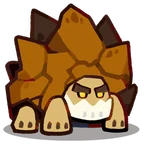

# Família Gibber
[← Catálogo](../tataris.md)

**Pedra · 4 formas cadastradas**

[Gibber · T1](#gibber) → [Turtuff · T2](#turtuff) → [Rockshell · T3](#rockshell) → [Terraton · T4](#terraton)

!!! info "Origem e revisão"
    Base da wiki.gg coletada em 09/10/2026 e preservada pelo Horde Drafter. As notas abaixo aplicam os patches fornecidos pelo mantenedor em 07/11/2026. Os textos de habilidades permanecem em inglês para preservar a descrição de origem. Valores de balanceamento não foram certificados para a temporada atual.

## Gibber · T1 {#gibber}

{ width=160 height=160 loading=lazy }

**Elemento:** Pedra · **Função:** Guardião · **Raridade:** Rara

### Habilidade normal

Spike Spiral: Launches a piercing spinning shell.

### Horda: níveis da partida

Os níveis 3, 5 e 7 abaixo são melhorias durante a Horda, independentes do grau T1–T4.

- **Nível 3 — Quake:** Periodically triggers an earthquake, dealing wide-range AoE damage.
- **Nível 5 — Shell Bounce:** Launches a shell that bounces between allies, granting each a Shell Shield and dealing damage to enemies.
- **Nível 7 — Shell Burst:** Launches piercing spinning shells in 8 directions.

[Página de origem e histórico de autores](https://clashofcritters.wiki.gg/wiki/Gibber)

## Turtuff · T2 {#turtuff}

{ width=160 height=160 loading=lazy }

**Elemento:** Pedra · **Função:** Guardião · **Raridade:** Rara

### Habilidade normal

Shield Spin: Launches a piercing spinning shell and grants a Shell Shield.

### Horda: níveis da partida

Os níveis 3, 5 e 7 abaixo são melhorias durante a Horda, independentes do grau T1–T4.

- **Nível 3 — Quake:** Periodically triggers an earthquake, dealing wide-range AoE damage.
- **Nível 5 — Shell Bounce:** Launches a shell that bounces between allies, granting each a Shell Shield and dealing damage to enemies.
- **Nível 7 — Shell Burst:** Launches piercing spinning shells in 8 directions.

[Página de origem e histórico de autores](https://clashofcritters.wiki.gg/wiki/Turtuff)

## Rockshell · T3 {#rockshell}

{ width=160 height=160 loading=lazy }

**Elemento:** Pedra · **Função:** Guardião · **Raridade:** Rara

### Habilidade normal

Guardian Gyro: Launches a piercing spinning shell that grants all allies it passes a Shell Shield.

### Horda: níveis da partida

Os níveis 3, 5 e 7 abaixo são melhorias durante a Horda, independentes do grau T1–T4.

- **Nível 3 — Quake:** Periodically triggers an earthquake, dealing wide-range AoE damage.
- **Nível 5 — Shell Bounce:** Launches a shell that bounces between allies, granting each a Shell Shield and dealing damage to enemies.
- **Nível 7 — Shell Burst:** Launches piercing spinning shells in 8 directions.

[Página de origem e histórico de autores](https://clashofcritters.wiki.gg/wiki/Rockshell)

## Terraton · T4 {#terraton}

{ width=160 height=160 loading=lazy }

**Elemento:** Pedra · **Função:** Guardião · **Raridade:** Rara

### Habilidade normal

Rock Swirl: Launches a piercing spinning shell that grants all allies it passes a Shell Shield. Terraton carries Aura: Rock whenever on the field.

### Horda: níveis da partida

Os níveis 3, 5 e 7 abaixo são melhorias durante a Horda, independentes do grau T1–T4.

- **Nível 3 — Quake:** Periodically triggers an earthquake, dealing wide-range AoE damage.
- **Nível 5 — Shell Bounce:** Launches a shell that bounces between allies, granting each a Shell Shield and dealing damage to enemies.
- **Nível 7 — Shell Burst:** Launches piercing spinning shells in 8 directions.

[Página de origem e histórico de autores](https://clashofcritters.wiki.gg/wiki/Terraton)

## Evolução e provas

Os nomes e graus acima descrevem a linhagem. Custos e tarefas não constam desta base e precisam ser conferidos no jogo. O patch de 04/11 substitui provas “Fishing Contest ou Zobo Shooter” por “Fishing Contest ou Artifact Adventure”, e “Raft Race ou Fishing Contest” por “Raft Race ou Zobo Shooter”, com transferência proporcional do progresso. Não há lista de famílias afetadas no anúncio.

## Fontes e créditos

Dados e descrições: colaboradores da [Clash of Critters Wiki](https://clashofcritters.wiki.gg/wiki/Tatari), via [Horde Drafter de Jeremy Canlas / jacc6475](https://github.com/jeremycanlas/clash-of-critters-horde-planner/tree/ec83738f3790c306e6e04d8b0878bdf388bd26e8). Textos derivados da wiki sob [CC BY-SA 4.0](https://creativecommons.org/licenses/by-sa/4.0/), com reorganização, rótulos traduzidos e notas de atualização pela Clash of Critters BR. Artes e conteúdo do jogo pertencem aos respectivos titulares; não são abrangidos pela licença MIT do código.

[Patches, limitações e política de atualização](../patches-tataris.md).
