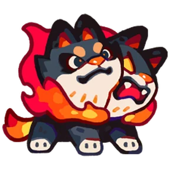
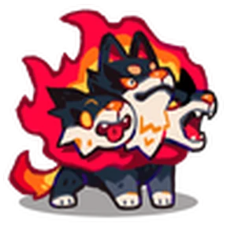
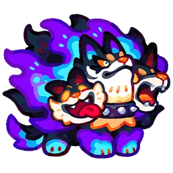

# Família Pyropup
[← Catálogo](../tataris.md)

**Fogo · 4 formas cadastradas**

[Pyropup · T1](#pyropup) → [Pyrohound · T2](#pyrohound) → [Hellhound · T3](#hellhound) → [Pyrodaemon · T4](#pyrodaemon)

!!! info "Origem e revisão"
    Base da wiki.gg coletada em 09/10/2026 e preservada pelo Horde Drafter. As notas abaixo aplicam os patches fornecidos pelo mantenedor em 07/11/2026. Os textos de habilidades permanecem em inglês para preservar a descrição de origem. Valores de balanceamento não foram certificados para a temporada atual.

!!! note "Patch oficial fornecido"
    04/11: adicionadas sete aparências Sparkle à evolução T4 desta família.

## Pyropup · T1 {#pyropup}

{ width=160 height=160 loading=lazy }

**Elemento:** Fogo · **Função:** Guardião · **Raridade:** Rara

### Habilidade normal

Pyro Pillar: Summons a fire pillar that deals AoE damage.

### Horda: níveis da partida

Os níveis 3, 5 e 7 abaixo são melhorias durante a Horda, independentes do grau T1–T4.

- **Nível 3 — Fire Serpent:** Attacks have a chance to summon extra fire pillars that extend outward randomly.
- **Nível 5 — Flame Halo:** Periodically creates rings of fire orbs, dealing DoT damage in an area to nearby enemies.
- **Nível 7 — Hellflame:** Continuously summons powerful flame pillars in the surrounding area.

[Página de origem e histórico de autores](https://clashofcritters.wiki.gg/wiki/Pyropup)

## Pyrohound · T2 {#pyrohound}

{ width=160 height=160 loading=lazy }

**Elemento:** Fogo · **Função:** Guardião · **Raridade:** Rara

### Habilidade normal

Inferno Spire: Summons a powerful fire pillar that deals AoE damage.

### Horda: níveis da partida

Os níveis 3, 5 e 7 abaixo são melhorias durante a Horda, independentes do grau T1–T4.

- **Nível 3 — Fire Serpent:** Attacks have a chance to summon extra fire pillars that extend outward randomly.
- **Nível 5 — Flame Halo:** Periodically creates rings of fire orbs, dealing DoT damage in an area to nearby enemies.
- **Nível 7 — Hellflame:** Continuously summons powerful flame pillars in the surrounding area.

[Página de origem e histórico de autores](https://clashofcritters.wiki.gg/wiki/Pyrohound)

## Hellhound · T3 {#hellhound}

{ width=160 height=160 loading=lazy }

**Elemento:** Fogo · **Função:** Guardião · **Raridade:** Rara

### Habilidade normal

Scorching Strike: Summons fearsome flames that deal large AoE damage and inflict Weak.

### Horda: níveis da partida

Os níveis 3, 5 e 7 abaixo são melhorias durante a Horda, independentes do grau T1–T4.

- **Nível 3 — Fire Serpent:** Attacks have a chance to summon extra fire pillars that extend outward randomly.
- **Nível 5 — Flame Halo:** Periodically creates rings of fire orbs, dealing DoT damage in an area to nearby enemies.
- **Nível 7 — Hellflame:** Continuously summons powerful flame pillars in the surrounding area.

[Página de origem e histórico de autores](https://clashofcritters.wiki.gg/wiki/Hellhound)

## Pyrodaemon · T4 {#pyrodaemon}

{ width=160 height=160 loading=lazy }

**Elemento:** Fogo · **Função:** Guardião · **Raridade:** Rara

### Habilidade normal

Hell Strike: Summons fearsome flames that deal large AoE damage and inflict Weak. Pyrodaemon carries Aura: Fire whenever on the field.

### Horda: níveis da partida

Os níveis 3, 5 e 7 abaixo são melhorias durante a Horda, independentes do grau T1–T4.

- **Nível 3 — Fire Serpent:** Attacks have a chance to summon extra fire pillars that extend outward randomly.
- **Nível 5 — Flame Halo:** Periodically creates rings of fire orbs, dealing DoT damage in an area to nearby enemies.
- **Nível 7 — Hellflame:** Continuously summons powerful flame pillars in the surrounding area.

[Página de origem e histórico de autores](https://clashofcritters.wiki.gg/wiki/Pyrodaemon)

## Evolução e provas

Os nomes e graus acima descrevem a linhagem. Custos e tarefas não constam desta base e precisam ser conferidos no jogo. O patch de 04/11 substitui provas “Fishing Contest ou Zobo Shooter” por “Fishing Contest ou Artifact Adventure”, e “Raft Race ou Fishing Contest” por “Raft Race ou Zobo Shooter”, com transferência proporcional do progresso. Não há lista de famílias afetadas no anúncio.

[Consultar a ficha anterior do Pyropup e suas provas](../guias/pyropup.md). Ela possui referência de versão própria; não equivale a validação integral pelo patch de novembro.

## Fontes e créditos

Dados e descrições: colaboradores da [Clash of Critters Wiki](https://clashofcritters.wiki.gg/wiki/Tatari), via [Horde Drafter de Jeremy Canlas / jacc6475](https://github.com/jeremycanlas/clash-of-critters-horde-planner/tree/ec83738f3790c306e6e04d8b0878bdf388bd26e8). Textos derivados da wiki sob [CC BY-SA 4.0](https://creativecommons.org/licenses/by-sa/4.0/), com reorganização, rótulos traduzidos e notas de atualização pela Clash of Critters BR. Artes e conteúdo do jogo pertencem aos respectivos titulares; não são abrangidos pela licença MIT do código.

[Patches, limitações e política de atualização](../patches-tataris.md).
