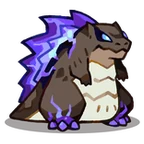

# Família Rubblet
[← Catálogo](../tataris.md)

**Pedra · 4 formas cadastradas**

[Rubblet · T1](#rubblet) → [Cobbledon · T2](#cobbledon) → [Rockzilla · T3](#rockzilla) → [Meteorax · T4](#meteorax)

!!! info "Origem e revisão"
    Base da wiki.gg coletada em 09/10/2026 e preservada pelo Horde Drafter. As notas abaixo aplicam os patches fornecidos pelo mantenedor em 07/11/2026. Descrições traduzidas pela comunidade; nomes de habilidades e efeitos próprios foram preservados para facilitar a consulta no jogo. Valores de balanceamento não foram certificados para a temporada atual.

## Rubblet · T1 {#rubblet}

{ width=160 height=160 loading=lazy }

**Elemento:** Pedra · **Função:** Guardião · **Raridade:** Rara

### Habilidade normal

Azure Flare: Dispara um feixe azul intenso que causa dano em área.

Consultar descrição original em inglês

Azure Flare: Fires a searing blue beam that deals AoE damage.

### Horda: níveis da partida

Os níveis 3, 5 e 7 abaixo são melhorias durante a Horda, independentes do grau T1–T4.

- **Nível 3 — Azure Shield:** Os ataques têm chance de conceder um Azure Shield extra.
- **Nível 5 — Heat Sweep:** Dispara um feixe de calor que varre a área, causando dano em área.
- **Nível 7 — Fault Line:** Os ataques provocam um terremoto, causando dano em uma área grande e aplicando Atordoamento.

[Página de origem e histórico de autores](https://clashofcritters.wiki.gg/wiki/Rubblet)

## Cobbledon · T2 {#cobbledon}

{ width=160 height=160 loading=lazy }

**Elemento:** Pedra · **Função:** Guardião · **Raridade:** Rara

### Habilidade normal

Colbalt Beam: Dispara feixes que se dividem e causam dano em área.

Consultar descrição original em inglês

Colbalt Beam: Fires splitting beams that deal AoE damage.

### Horda: níveis da partida

Os níveis 3, 5 e 7 abaixo são melhorias durante a Horda, independentes do grau T1–T4.

- **Nível 3 — Azure Shield:** Os ataques têm chance de conceder um Azure Shield extra.
- **Nível 5 — Heat Sweep:** Dispara um feixe de calor que varre a área, causando dano em área.
- **Nível 7 — Fault Line:** Os ataques provocam um terremoto, causando dano em uma área grande e aplicando Atordoamento.

[Página de origem e histórico de autores](https://clashofcritters.wiki.gg/wiki/Cobbledon)

## Rockzilla · T3 {#rockzilla}

{ width=160 height=160 loading=lazy }

**Elemento:** Pedra · **Função:** Guardião · **Raridade:** Rara

### Habilidade normal

Atomic Ray: Dispara feixes intensos que causam dano em área. Às vezes realiza um golpe poderoso.

Consultar descrição original em inglês

Atomic Ray: Fires blazing beams that deal AoE damage. Sometimes lands a powerful hit.

### Horda: níveis da partida

Os níveis 3, 5 e 7 abaixo são melhorias durante a Horda, independentes do grau T1–T4.

- **Nível 3 — Azure Shield:** Os ataques têm chance de conceder um Azure Shield extra.
- **Nível 5 — Heat Sweep:** Dispara um feixe de calor que varre a área, causando dano em área.
- **Nível 7 — Fault Line:** Os ataques provocam um terremoto, causando dano em uma área grande e aplicando Atordoamento.

[Página de origem e histórico de autores](https://clashofcritters.wiki.gg/wiki/Rockzilla)

## Meteorax · T4 {#meteorax}

{ width=160 height=160 loading=lazy }

**Elemento:** Pedra · **Função:** Guardião · **Raridade:** Rara

### Habilidade normal

Blaze Beam: Dispara feixes extremamente intensos que causam dano em área. Às vezes realiza um golpe muito poderoso. Meteorax possui Aura: Rock enquanto está no campo.

Consultar descrição original em inglês

Blaze Beam: Fires ultra blazing beams that deal AoE damage. Sometimes lands a super powerful hit. Meteorax carries Aura: Rock whenever on the field.

### Horda: níveis da partida

Os níveis 3, 5 e 7 abaixo são melhorias durante a Horda, independentes do grau T1–T4.

- **Nível 3 — Azure Shield:** Os ataques têm chance de conceder um Azure Shield extra.
- **Nível 5 — Heat Sweep:** Dispara um feixe de calor que varre a área, causando dano em área.
- **Nível 7 — Fault Line:** Os ataques provocam um terremoto, causando dano em uma área grande e aplicando Atordoamento.

[Página de origem e histórico de autores](https://clashofcritters.wiki.gg/wiki/Meteorax)

## Evolução e provas

A raridade indicada acima vem do campo Common/Rare da base. Ela é distinta do grau T1–T4 e das cores de evolução usadas em outros guias.

Os nomes e graus acima descrevem a linhagem. Custos e tarefas não constam desta base e precisam ser conferidos no jogo. O patch de 04/11 substitui provas “Fishing Contest ou Zobo Shooter” por “Fishing Contest ou Artifact Adventure”, e “Raft Race ou Fishing Contest” por “Raft Race ou Zobo Shooter”, com transferência proporcional do progresso. Não há lista de famílias afetadas no anúncio.

## Fontes e créditos

Dados e descrições: colaboradores da [Clash of Critters Wiki](https://clashofcritters.wiki.gg/wiki/Tatari), via [Horde Drafter de Jeremy Canlas / jacc6475](https://github.com/jeremycanlas/clash-of-critters-horde-planner/tree/ec83738f3790c306e6e04d8b0878bdf388bd26e8). Textos derivados da wiki sob [CC BY-SA 4.0](https://creativecommons.org/licenses/by-sa/4.0/), com reorganização, descrições e rótulos traduzidos e notas de atualização pela Clash of Critters BR. Artes e conteúdo do jogo pertencem aos respectivos titulares; não são abrangidos pela licença MIT do código.

[Patches, glossário, limitações e política de atualização](../patches-tataris.md).
