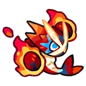

# Família Shrimpyro
[← Catálogo](../tataris.md)

**Fogo · 4 formas cadastradas**

[Shrimpyro · T1](#shrimpyro) → [Pyroprawn · T2](#pyroprawn) → [Pyroclobster · T3](#pyroclobster) → [Pyroviathan · T4](#pyroviathan)

!!! info "Origem e revisão"
    Base da wiki.gg coletada em 09/10/2026 e preservada pelo Horde Drafter. As notas abaixo aplicam os patches fornecidos pelo mantenedor em 07/11/2026. Descrições traduzidas pela comunidade; nomes de habilidades e efeitos próprios foram preservados para facilitar a consulta no jogo. Valores de balanceamento não foram certificados para a temporada atual.

## Shrimpyro · T1 {#shrimpyro}

{ width=160 height=160 loading=lazy }

**Elemento:** Fogo · **Função:** Dano · **Raridade:** Rara

### Habilidade normal

Quick Jabs: Desfere socos rapidamente.

Consultar descrição original em inglês

Quick Jabs: Quickly throws punches.

### Horda: níveis da partida

Os níveis 3, 5 e 7 abaixo são melhorias durante a Horda, independentes do grau T1–T4.

- **Nível 3 — Scattered Jabs:** Os ataques têm chance de disparar 3 ondas de socos dispersos.
- **Nível 5 — Blasting Jabs:** Os ataques têm chance de causar dano em uma área pequena ao acertar inimigos.
- **Nível 7 — Piercing Jabs:** Dispara várias ondas de socos em leque.

[Página de origem e histórico de autores](https://clashofcritters.wiki.gg/wiki/Shrimpyro)

## Pyroprawn · T2 {#pyroprawn}

{ width=160 height=160 loading=lazy }

**Elemento:** Fogo · **Função:** Dano · **Raridade:** Rara

### Habilidade normal

Fire Fists: Desfere socos rapidamente, às vezes aplicando Queimadura.

Consultar descrição original em inglês

Fire Fists: Quickly throws punches, sometimes inflicting Burn.

### Horda: níveis da partida

Os níveis 3, 5 e 7 abaixo são melhorias durante a Horda, independentes do grau T1–T4.

- **Nível 3 — Scattered Jabs:** Os ataques têm chance de disparar 3 ondas de socos dispersos.
- **Nível 5 — Blasting Jabs:** Os ataques têm chance de causar dano em uma área pequena ao acertar inimigos.
- **Nível 7 — Piercing Jabs:** Dispara várias ondas de socos em leque.

[Página de origem e histórico de autores](https://clashofcritters.wiki.gg/wiki/Pyroprawn)

## Pyroclobster · T3 {#pyroclobster}

{ width=160 height=160 loading=lazy }

**Elemento:** Fogo · **Função:** Dano · **Raridade:** Rara

### Habilidade normal

Flame Flurry: Desfere socos rapidamente, às vezes aplicando Queimadura. Causa mais dano a inimigos com Queimadura.

Consultar descrição original em inglês

Flame Flurry: Quickly throws punches, sometimes inflicting Burn. Deals more damage to Burning enemies.

### Horda: níveis da partida

Os níveis 3, 5 e 7 abaixo são melhorias durante a Horda, independentes do grau T1–T4.

- **Nível 3 — Scattered Jabs:** Os ataques têm chance de disparar 3 ondas de socos dispersos.
- **Nível 5 — Blasting Jabs:** Os ataques têm chance de causar dano em uma área pequena ao acertar inimigos.
- **Nível 7 — Piercing Jabs:** Dispara várias ondas de socos em leque.

[Página de origem e histórico de autores](https://clashofcritters.wiki.gg/wiki/Pyroclobster)

## Pyroviathan · T4 {#pyroviathan}

{ width=160 height=160 loading=lazy }

**Elemento:** Fogo · **Função:** Dano · **Raridade:** Rara

### Habilidade normal

Blaze Inferno: Desfere socos rapidamente, às vezes aplicando Queimadura. Causa mais dano a inimigos com Queimadura. Pyroviathan possui Aura: Fire enquanto está no campo.

Consultar descrição original em inglês

Blaze Inferno: Quickly throws punches, sometimes inflicting Burn. Deals more damage to Burning enemies. Pyroviathan carries Aura: Fire whenever on the field.

### Horda: níveis da partida

Os níveis 3, 5 e 7 abaixo são melhorias durante a Horda, independentes do grau T1–T4.

- **Nível 3 — Scattered Jabs:** Os ataques têm chance de disparar 3 ondas de socos dispersos.
- **Nível 5 — Blasting Jabs:** Os ataques têm chance de causar dano em uma área pequena ao acertar inimigos.
- **Nível 7 — Piercing Jabs:** Dispara várias ondas de socos em leque.

[Página de origem e histórico de autores](https://clashofcritters.wiki.gg/wiki/Pyroviathan)

## Evolução e provas

A raridade indicada acima vem do campo Common/Rare da base. Ela é distinta do grau T1–T4 e das cores de evolução usadas em outros guias.

Os nomes e graus acima descrevem a linhagem. Custos e tarefas não constam desta base e precisam ser conferidos no jogo. O patch de 04/11 substitui provas “Fishing Contest ou Zobo Shooter” por “Fishing Contest ou Artifact Adventure”, e “Raft Race ou Fishing Contest” por “Raft Race ou Zobo Shooter”, com transferência proporcional do progresso. Não há lista de famílias afetadas no anúncio.

## Fontes e créditos

Dados e descrições: colaboradores da [Clash of Critters Wiki](https://clashofcritters.wiki.gg/wiki/Tatari), via [Horde Drafter de Jeremy Canlas / jacc6475](https://github.com/jeremycanlas/clash-of-critters-horde-planner/tree/ec83738f3790c306e6e04d8b0878bdf388bd26e8). Textos derivados da wiki sob [CC BY-SA 4.0](https://creativecommons.org/licenses/by-sa/4.0/), com reorganização, descrições e rótulos traduzidos e notas de atualização pela Clash of Critters BR. Artes e conteúdo do jogo pertencem aos respectivos titulares; não são abrangidos pela licença MIT do código.

[Patches, glossário, limitações e política de atualização](../patches-tataris.md).
