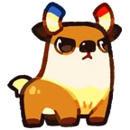

# Família Voltfawn
[← Catálogo](../tataris.md)

**Elétrico · 4 formas cadastradas**

[Voltfawn · T1](#voltfawn) → [Sparkdoe · T2](#sparkdoe) → [Zapantler · T3](#zapantler) → [Magnedart · T4](#magnedart)

!!! info "Origem e revisão"
    Base da wiki.gg coletada em 09/10/2026 e preservada pelo Horde Drafter. As notas abaixo aplicam os patches fornecidos pelo mantenedor em 07/11/2026. Descrições traduzidas pela comunidade; nomes de habilidades e efeitos próprios foram preservados para facilitar a consulta no jogo. Valores de balanceamento não foram certificados para a temporada atual.

## Voltfawn · T1 {#voltfawn}

{ width=160 height=160 loading=lazy }

**Elemento:** Elétrico · **Função:** Dano · **Raridade:** Rara

### Habilidade normal

Stun Spear: Dispara uma lança elétrica que atravessa inimigos e aplica Paralisia.

Consultar descrição original em inglês

Stun Spear: Fires a lightning lance that pierces enemies and inflicts Paralysis.

### Horda: níveis da partida

Os níveis 3, 5 e 7 abaixo são melhorias durante a Horda, independentes do grau T1–T4.

- **Nível 3 — Scatter Bolt:** Os ataques têm chance de disparar um raio disperso extra.
- **Nível 5 — Bolt Trigger:** Ao aplicar Paralisia, tem chance de disparar uma esfera elétrica adicional no local do alvo.
- **Nível 7 — Super Bolt:** Lança uma lança elétrica enorme que causa dano em uma área grande com chance de aplicar Paralisia.

[Página de origem e histórico de autores](https://clashofcritters.wiki.gg/wiki/Voltfawn)

## Sparkdoe · T2 {#sparkdoe}

{ width=160 height=160 loading=lazy }

**Elemento:** Elétrico · **Função:** Dano · **Raridade:** Rara

### Habilidade normal

Bolt Spire: Dispara uma lança elétrica poderosa que atravessa inimigos e aplica Paralisia.

Consultar descrição original em inglês

Bolt Spire: Fires a powerful lightning lance that pierces enemies and inflicts Paralysis.

### Horda: níveis da partida

Os níveis 3, 5 e 7 abaixo são melhorias durante a Horda, independentes do grau T1–T4.

- **Nível 3 — Scatter Bolt:** Os ataques têm chance de disparar um raio disperso extra.
- **Nível 5 — Bolt Trigger:** Ao aplicar Paralisia, tem chance de disparar uma esfera elétrica adicional no local do alvo.
- **Nível 7 — Super Bolt:** Lança uma lança elétrica enorme que causa dano em uma área grande com chance de aplicar Paralisia.

[Página de origem e histórico de autores](https://clashofcritters.wiki.gg/wiki/Sparkdoe)

## Zapantler · T3 {#zapantler}

{ width=160 height=160 loading=lazy }

**Elemento:** Elétrico · **Função:** Dano · **Raridade:** Rara

### Habilidade normal

Volt Storm: Dispara uma lança elétrica especial que atravessa inimigos e aplica Paralisia. Às vezes a perfuração não para.

Consultar descrição original em inglês

Volt Storm: Fires a special lightning lance that pierces enemies and inflicts Paralysis. Sometimes the piercing never stops.

### Horda: níveis da partida

Os níveis 3, 5 e 7 abaixo são melhorias durante a Horda, independentes do grau T1–T4.

- **Nível 3 — Scatter Bolt:** Os ataques têm chance de disparar um raio disperso extra.
- **Nível 5 — Bolt Trigger:** Ao aplicar Paralisia, tem chance de disparar uma esfera elétrica adicional no local do alvo.
- **Nível 7 — Super Bolt:** Lança uma lança elétrica enorme que causa dano em uma área grande com chance de aplicar Paralisia.

[Página de origem e histórico de autores](https://clashofcritters.wiki.gg/wiki/Zapantler)

## Magnedart · T4 {#magnedart}

{ width=160 height=160 loading=lazy }

**Elemento:** Elétrico · **Função:** Dano · **Raridade:** Rara

### Habilidade normal

Super Bolt: Lança uma superlança elétrica que atravessa inimigos e aplica Paralisia. Às vezes a perfuração não para. Magnedart possui Aura: Lightning enquanto está no campo.

Consultar descrição original em inglês

Super Bolt: Launches a super lightning lance pierces enemies and inflicts Paralysis. Sometimes the piercing never stops. Magnedart carries Aura: Lightning whenever on the field.

### Horda: níveis da partida

Os níveis 3, 5 e 7 abaixo são melhorias durante a Horda, independentes do grau T1–T4.

- **Nível 3 — Scatter Bolt:** Os ataques têm chance de disparar um raio disperso extra.
- **Nível 5 — Bolt Trigger:** Ao aplicar Paralisia, tem chance de disparar uma esfera elétrica adicional no local do alvo.
- **Nível 7 — Super Bolt:** Lança uma lança elétrica enorme que causa dano em uma área grande com chance de aplicar Paralisia.

[Página de origem e histórico de autores](https://clashofcritters.wiki.gg/wiki/Magnedart)

## Evolução e provas

Os nomes e graus acima descrevem a linhagem. Custos e tarefas não constam desta base e precisam ser conferidos no jogo. O patch de 04/11 substitui provas “Fishing Contest ou Zobo Shooter” por “Fishing Contest ou Artifact Adventure”, e “Raft Race ou Fishing Contest” por “Raft Race ou Zobo Shooter”, com transferência proporcional do progresso. Não há lista de famílias afetadas no anúncio.

## Fontes e créditos

Dados e descrições: colaboradores da [Clash of Critters Wiki](https://clashofcritters.wiki.gg/wiki/Tatari), via [Horde Drafter de Jeremy Canlas / jacc6475](https://github.com/jeremycanlas/clash-of-critters-horde-planner/tree/ec83738f3790c306e6e04d8b0878bdf388bd26e8). Textos derivados da wiki sob [CC BY-SA 4.0](https://creativecommons.org/licenses/by-sa/4.0/), com reorganização, descrições e rótulos traduzidos e notas de atualização pela Clash of Critters BR. Artes e conteúdo do jogo pertencem aos respectivos titulares; não são abrangidos pela licença MIT do código.

[Patches, glossário, limitações e política de atualização](../patches-tataris.md).
