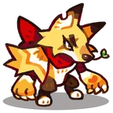

# Família Voltkit
[← Catálogo](../tataris.md)

**Elétrico · 4 formas cadastradas**

[Voltkit · T1](#voltkit) → [Voltling · T2](#voltling) → [Voltverine · T3](#voltverine) → [Voltreaver · T4](#voltreaver)

!!! info "Origem e revisão"
    Base da wiki.gg coletada em 09/10/2026 e preservada pelo Horde Drafter. As notas abaixo aplicam os patches fornecidos pelo mantenedor em 07/11/2026. Descrições traduzidas pela comunidade; nomes de habilidades e efeitos próprios foram preservados para facilitar a consulta no jogo. Valores de balanceamento não foram certificados para a temporada atual.

## Voltkit · T1 {#voltkit}

{ width=160 height=160 loading=lazy }

**Elemento:** Elétrico · **Função:** Guardião · **Raridade:** Rara

### Habilidade normal

Duskrush: Libera um ataque de sombras que causa dano em área.

Consultar descrição original em inglês

Duskrush: Unleashes a shadow attack that deals AoE damage.

### Horda: níveis da partida

Os níveis 3, 5 e 7 abaixo são melhorias durante a Horda, independentes do grau T1–T4.

- **Nível 3 — Phantom Hit:** Os ataques têm chance de ativar um golpe de sombras extra, que pode continuar ativando golpes de sombras adicionais.
- **Nível 5 — Target Lock:** Marca 1 inimigo e causa dano contínuo em área ao redor dele.
- **Nível 7 — Bolt Slash:** Desaparece brevemente e percorre o campo, causando dano em uma área grande.

[Página de origem e histórico de autores](https://clashofcritters.wiki.gg/wiki/Voltkit)

## Voltling · T2 {#voltling}

{ width=160 height=160 loading=lazy }

**Elemento:** Elétrico · **Função:** Guardião · **Raridade:** Rara

### Habilidade normal

Eboncharge: Libera um ataque de sombras que causa dano em área e aplica Paralisia.

Consultar descrição original em inglês

Eboncharge: Unleashes a shadow attack that deals AoE damage and inflicts Paralysis.

### Horda: níveis da partida

Os níveis 3, 5 e 7 abaixo são melhorias durante a Horda, independentes do grau T1–T4.

- **Nível 3 — Phantom Hit:** Os ataques têm chance de ativar um golpe de sombras extra, que pode continuar ativando golpes de sombras adicionais.
- **Nível 5 — Target Lock:** Marca 1 inimigo e causa dano contínuo em área ao redor dele.
- **Nível 7 — Bolt Slash:** Desaparece brevemente e percorre o campo, causando dano em uma área grande.

[Página de origem e histórico de autores](https://clashofcritters.wiki.gg/wiki/Voltling)

## Voltverine · T3 {#voltverine}

{ width=160 height=160 loading=lazy }

**Elemento:** Elétrico · **Função:** Guardião · **Raridade:** Rara

### Habilidade normal

Phantom Storm: Libera um ataque de sombras que causa dano em área e aplica Paralisia. Recebe Invencibilidade breve ao atacar.

Consultar descrição original em inglês

Phantom Storm: Unleashes a shadow attack that deals AoE damage and inflicts Paralysis. Gains brief Invincibility when attacking.

### Horda: níveis da partida

Os níveis 3, 5 e 7 abaixo são melhorias durante a Horda, independentes do grau T1–T4.

- **Nível 3 — Phantom Hit:** Os ataques têm chance de ativar um golpe de sombras extra, que pode continuar ativando golpes de sombras adicionais.
- **Nível 5 — Target Lock:** Marca 1 inimigo e causa dano contínuo em área ao redor dele.
- **Nível 7 — Bolt Slash:** Desaparece brevemente e percorre o campo, causando dano em uma área grande.

[Página de origem e histórico de autores](https://clashofcritters.wiki.gg/wiki/Voltverine)

## Voltreaver · T4 {#voltreaver}

{ width=160 height=160 loading=lazy }

**Elemento:** Elétrico · **Função:** Guardião · **Raridade:** Rara

### Habilidade normal

Shadow Strike: Libera um ataque de sombras que causa dano em área e aplica Paralisia. Recebe Invencibilidade breve ao atacar. Voltreaver possui Aura: Lightning enquanto está no campo.

Consultar descrição original em inglês

Shadow Strike: Unleashes a shadow attack that deals AoE damage and inflicts Paralysis. Gains brief Invincibility when attacking. Voltreaver carries Aura: Lightning whenever on the field.

### Horda: níveis da partida

Os níveis 3, 5 e 7 abaixo são melhorias durante a Horda, independentes do grau T1–T4.

- **Nível 3 — Phantom Hit:** Os ataques têm chance de ativar um golpe de sombras extra, que pode continuar ativando golpes de sombras adicionais.
- **Nível 5 — Target Lock:** Marca 1 inimigo e causa dano contínuo em área ao redor dele.
- **Nível 7 — Bolt Slash:** Desaparece brevemente e percorre o campo, causando dano em uma área grande.

[Página de origem e histórico de autores](https://clashofcritters.wiki.gg/wiki/Voltreaver)

## Evolução e provas

Os nomes e graus acima descrevem a linhagem. Custos e tarefas não constam desta base e precisam ser conferidos no jogo. O patch de 04/11 substitui provas “Fishing Contest ou Zobo Shooter” por “Fishing Contest ou Artifact Adventure”, e “Raft Race ou Fishing Contest” por “Raft Race ou Zobo Shooter”, com transferência proporcional do progresso. Não há lista de famílias afetadas no anúncio.

## Fontes e créditos

Dados e descrições: colaboradores da [Clash of Critters Wiki](https://clashofcritters.wiki.gg/wiki/Tatari), via [Horde Drafter de Jeremy Canlas / jacc6475](https://github.com/jeremycanlas/clash-of-critters-horde-planner/tree/ec83738f3790c306e6e04d8b0878bdf388bd26e8). Textos derivados da wiki sob [CC BY-SA 4.0](https://creativecommons.org/licenses/by-sa/4.0/), com reorganização, descrições e rótulos traduzidos e notas de atualização pela Clash of Critters BR. Artes e conteúdo do jogo pertencem aos respectivos titulares; não são abrangidos pela licença MIT do código.

[Patches, glossário, limitações e política de atualização](../patches-tataris.md).
