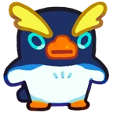

# Família Waddledo
[← Catálogo](../tataris.md)

**Água · 4 formas cadastradas**

[Waddledo · T1](#waddledo) → [Swaystroll · T2](#swaystroll) → [Stoodbeak · T3](#stoodbeak) → [Glideflip · T4](#glideflip)

!!! info "Origem e revisão"
    Base da wiki.gg coletada em 09/10/2026 e preservada pelo Horde Drafter. As notas abaixo aplicam os patches fornecidos pelo mantenedor em 07/11/2026. Descrições traduzidas pela comunidade; nomes de habilidades e efeitos próprios foram preservados para facilitar a consulta no jogo. Valores de balanceamento não foram certificados para a temporada atual.

## Waddledo · T1 {#waddledo}

{ width=160 height=160 loading=lazy }

**Elemento:** Água · **Função:** Tanque · **Raridade:** Rara

### Habilidade normal

Icepad Bash: Recebe um Ice Shield e dispara cristais de gelo quando o escudo desaparece, causando dano em área.

Consultar descrição original em inglês

Icepad Bash: Gains an Ice Shield and fires ice crystals when the shield disappears, dealing AoE damage.

### Horda: níveis da partida

Os níveis 3, 5 e 7 abaixo são melhorias durante a Horda, independentes do grau T1–T4.

- **Nível 3 — Ice Strike:** Os ataques têm chance de disparar 6 fragmentos de gelo extras.
- **Nível 5 — Shield Gift:** Ao receber um Escudo, tem chance de conceder aos aliados próximos uma versão mais fraca de Ice Shield.
- **Nível 7 — Ice Show:** Invoca uma fileira de esculturas de gelo que podem ser atacadas e explodem ao desaparecer, causando dano em área.

[Página de origem e histórico de autores](https://clashofcritters.wiki.gg/wiki/Waddledo)

## Swaystroll · T2 {#swaystroll}

{ width=160 height=160 loading=lazy }

**Elemento:** Água · **Função:** Tanque · **Raridade:** Rara

### Habilidade normal

Icewall Smash: Recebe um Ice Shield e acumula energia. Dispara cristais de gelo quando o escudo desaparece, causando dano em área conforme o tempo de carregamento.

Consultar descrição original em inglês

Icewall Smash: Gains an Ice Shield and charges up. Fires ice crystals when the shield disappears, dealing AoE damage based on the charging time.

### Horda: níveis da partida

Os níveis 3, 5 e 7 abaixo são melhorias durante a Horda, independentes do grau T1–T4.

- **Nível 3 — Ice Strike:** Os ataques têm chance de disparar 6 fragmentos de gelo extras.
- **Nível 5 — Shield Gift:** Ao receber um Escudo, tem chance de conceder aos aliados próximos uma versão mais fraca de Ice Shield.
- **Nível 7 — Ice Show:** Invoca uma fileira de esculturas de gelo que podem ser atacadas e explodem ao desaparecer, causando dano em área.

[Página de origem e histórico de autores](https://clashofcritters.wiki.gg/wiki/Swaystroll)

## Stoodbeak · T3 {#stoodbeak}

{ width=160 height=160 loading=lazy }

**Elemento:** Água · **Função:** Tanque · **Raridade:** Rara

### Habilidade normal

Frostbust: Recebe um Ice Shield e dispara cristais de gelo quando o escudo desaparece, causando dano em área com carga completa. Ao ser derrubado, transforma-se em uma escultura de gelo.

Consultar descrição original em inglês

Frostbust: Gains an Ice Shield ad fires ice crystals when the shield disappears, dealing fully-charged AoE damage. When knocked down, transforms into an Ice Sculpture.

### Horda: níveis da partida

Os níveis 3, 5 e 7 abaixo são melhorias durante a Horda, independentes do grau T1–T4.

- **Nível 3 — Ice Strike:** Os ataques têm chance de disparar 6 fragmentos de gelo extras.
- **Nível 5 — Shield Gift:** Ao receber um Escudo, tem chance de conceder aos aliados próximos uma versão mais fraca de Ice Shield.
- **Nível 7 — Ice Show:** Invoca uma fileira de esculturas de gelo que podem ser atacadas e explodem ao desaparecer, causando dano em área.

[Página de origem e histórico de autores](https://clashofcritters.wiki.gg/wiki/Stoodbeak)

## Glideflip · T4 {#glideflip}

{ width=160 height=160 loading=lazy }

**Elemento:** Água · **Função:** Tanque · **Raridade:** Rara

### Habilidade normal

Iceshield Counter: Recebe um Ice Shield e dispara cristais de gelo quando o escudo desaparece, causando dano em área com carga completa. Ao ser derrubado, transforma-se em uma escultura de gelo. Glideflip possui Aura: Water, recuperando HP de todos os aliados enquanto está no campo.

Consultar descrição original em inglês

Iceshield Counter: Gains an Ice Shield and fires ice crystals when the shield disappears, dealing fully-charged AoE damage. When knocked down, transforms into an Ice Sculpture. Glideflip carries Aura: Water, recovering HP for all allies whenever on the field.

### Horda: níveis da partida

Os níveis 3, 5 e 7 abaixo são melhorias durante a Horda, independentes do grau T1–T4.

- **Nível 3 — Ice Strike:** Os ataques têm chance de disparar 6 fragmentos de gelo extras.
- **Nível 5 — Shield Gift:** Ao receber um Escudo, tem chance de conceder aos aliados próximos uma versão mais fraca de Ice Shield.
- **Nível 7 — Ice Show:** Invoca uma fileira de esculturas de gelo que podem ser atacadas e explodem ao desaparecer, causando dano em área.

[Página de origem e histórico de autores](https://clashofcritters.wiki.gg/wiki/Glideflip)

## Evolução e provas

A raridade indicada acima vem do campo Common/Rare da base. Ela é distinta do grau T1–T4 e das cores de evolução usadas em outros guias.

Os nomes e graus acima descrevem a linhagem. Custos e tarefas não constam desta base e precisam ser conferidos no jogo. O patch de 04/11 substitui provas “Fishing Contest ou Zobo Shooter” por “Fishing Contest ou Artifact Adventure”, e “Raft Race ou Fishing Contest” por “Raft Race ou Zobo Shooter”, com transferência proporcional do progresso. Não há lista de famílias afetadas no anúncio.

## Fontes e créditos

Dados e descrições: colaboradores da [Clash of Critters Wiki](https://clashofcritters.wiki.gg/wiki/Tatari), via [Horde Drafter de Jeremy Canlas / jacc6475](https://github.com/jeremycanlas/clash-of-critters-horde-planner/tree/ec83738f3790c306e6e04d8b0878bdf388bd26e8). Textos derivados da wiki sob [CC BY-SA 4.0](https://creativecommons.org/licenses/by-sa/4.0/), com reorganização, descrições e rótulos traduzidos e notas de atualização pela Clash of Critters BR. Artes e conteúdo do jogo pertencem aos respectivos titulares; não são abrangidos pela licença MIT do código.

[Patches, glossário, limitações e política de atualização](../patches-tataris.md).
