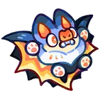

# Família Zaplet
[← Catálogo](../tataris.md)

**Elétrico · 4 formas cadastradas**

[Zaplet · T1](#zaplet) → [Synthhog · T2](#synthhog) → [Sonarbat · T3](#sonarbat) → [Umbraveil · T4](#umbraveil)

!!! info "Origem e revisão"
    Base da wiki.gg coletada em 09/10/2026 e preservada pelo Horde Drafter. As notas abaixo aplicam os patches fornecidos pelo mantenedor em 07/11/2026. Descrições traduzidas pela comunidade; nomes de habilidades e efeitos próprios foram preservados para facilitar a consulta no jogo. Valores de balanceamento não foram certificados para a temporada atual.

## Zaplet · T1 {#zaplet}

{ width=160 height=160 loading=lazy }

**Elemento:** Elétrico · **Função:** Especialista · **Raridade:** Rara

### Habilidade normal

Echo Electro: Aplica Scouted aos inimigos em uma área ampla. Quando Scouted termina, os inimigos afetados sofrem dano.

Consultar descrição original em inglês

Echo Electro: Inflicts Scouted on enemies over a wide area. When Scouted expires, affected enemies take damage.

### Horda: níveis da partida

Os níveis 3, 5 e 7 abaixo são melhorias durante a Horda, independentes do grau T1–T4.

- **Nível 3 — Resonant Echoes:** Concede um pequeno Aumento de Dano aos seus Tataris aliados e um grande Aumento de Dano aos Tataris do seu companheiro de equipe.
- **Nível 5 — Bat Swarm:** Invoca um enxame de morcegos que causa dano em uma área grande à frente enquanto cura aliados dentro do alcance.
- **Nível 7 — Radar Rage:** Mira em vários locais para causar dano contínuo em uma área pequena. Prioriza as posições dos chefes.

[Página de origem e histórico de autores](https://clashofcritters.wiki.gg/wiki/Zaplet)

## Synthhog · T2 {#synthhog}

{ width=160 height=160 loading=lazy }

**Elemento:** Elétrico · **Função:** Especialista · **Raridade:** Rara

### Habilidade normal

Wave Rave: Aplica Scouted e Bat: Fragile aos inimigos em uma área ampla. Quando Scouted termina, os inimigos afetados sofrem dano.

Consultar descrição original em inglês

Wave Rave: Inflicts Scouted and Bat: Fragile on enemies over a wide area. When Scouted expires, affected enemies take damage.

### Horda: níveis da partida

Os níveis 3, 5 e 7 abaixo são melhorias durante a Horda, independentes do grau T1–T4.

- **Nível 3 — Resonant Echoes:** Concede um pequeno Aumento de Dano aos seus Tataris aliados e um grande Aumento de Dano aos Tataris do seu companheiro de equipe.
- **Nível 5 — Bat Swarm:** Invoca um enxame de morcegos que causa dano em uma área grande à frente enquanto cura aliados dentro do alcance.
- **Nível 7 — Radar Rage:** Mira em vários locais para causar dano contínuo em uma área pequena. Prioriza as posições dos chefes.

[Página de origem e histórico de autores](https://clashofcritters.wiki.gg/wiki/Synthhog)

## Sonarbat · T3 {#sonarbat}

{ width=160 height=160 loading=lazy }

**Elemento:** Elétrico · **Função:** Especialista · **Raridade:** Rara

### Habilidade normal

Sonar Power: Aplica Perfectly Scouted e Bat: Fragile aos inimigos em uma área ampla. Quando Perfectly Scouted termina, os inimigos afetados sofrem dano.

Consultar descrição original em inglês

Sonar Power: Inflicts Perfectly Scouted and Bat: Fragile on enemies over a wide area. When Perfectly Scouted expires, affected enemies take damage.

### Horda: níveis da partida

Os níveis 3, 5 e 7 abaixo são melhorias durante a Horda, independentes do grau T1–T4.

- **Nível 3 — Resonant Echoes:** Concede um pequeno Aumento de Dano aos seus Tataris aliados e um grande Aumento de Dano aos Tataris do seu companheiro de equipe.
- **Nível 5 — Bat Swarm:** Invoca um enxame de morcegos que causa dano em uma área grande à frente enquanto cura aliados dentro do alcance.
- **Nível 7 — Radar Rage:** Mira em vários locais para causar dano contínuo em uma área pequena. Prioriza as posições dos chefes.

[Página de origem e histórico de autores](https://clashofcritters.wiki.gg/wiki/Sonarbat)

## Umbraveil · T4 {#umbraveil}

{ width=160 height=160 loading=lazy }

**Elemento:** Elétrico · **Função:** Especialista · **Raridade:** Rara

### Habilidade normal

Umbra Unleashed: Aplica Perfectly Scouted e Bat: Fragile aos inimigos em uma área ampla. Quando Perfectly Scouted termina, os inimigos afetados sofrem dano. Umbraveil possui Aura: Lightning enquanto está no campo.

Consultar descrição original em inglês

Umbra Unleashed: Inflicts Perfectly Scouted and Bat: Fragile on enemies over a wide area. When Perfectly Scouted expires, affected enemies take damage. Umbraveil carries Aura: Lightning whenever on the field.

### Horda: níveis da partida

Os níveis 3, 5 e 7 abaixo são melhorias durante a Horda, independentes do grau T1–T4.

- **Nível 3 — Resonant Echoes:** Concede um pequeno Aumento de Dano aos seus Tataris aliados e um grande Aumento de Dano aos Tataris do seu companheiro de equipe.
- **Nível 5 — Bat Swarm:** Invoca um enxame de morcegos que causa dano em uma área grande à frente enquanto cura aliados dentro do alcance.
- **Nível 7 — Radar Rage:** Mira em vários locais para causar dano contínuo em uma área pequena. Prioriza as posições dos chefes.

[Página de origem e histórico de autores](https://clashofcritters.wiki.gg/wiki/Umbraveil)

## Evolução e provas

Os nomes e graus acima descrevem a linhagem. Custos e tarefas não constam desta base e precisam ser conferidos no jogo. O patch de 04/11 substitui provas “Fishing Contest ou Zobo Shooter” por “Fishing Contest ou Artifact Adventure”, e “Raft Race ou Fishing Contest” por “Raft Race ou Zobo Shooter”, com transferência proporcional do progresso. Não há lista de famílias afetadas no anúncio.

## Fontes e créditos

Dados e descrições: colaboradores da [Clash of Critters Wiki](https://clashofcritters.wiki.gg/wiki/Tatari), via [Horde Drafter de Jeremy Canlas / jacc6475](https://github.com/jeremycanlas/clash-of-critters-horde-planner/tree/ec83738f3790c306e6e04d8b0878bdf388bd26e8). Textos derivados da wiki sob [CC BY-SA 4.0](https://creativecommons.org/licenses/by-sa/4.0/), com reorganização, descrições e rótulos traduzidos e notas de atualização pela Clash of Critters BR. Artes e conteúdo do jogo pertencem aos respectivos titulares; não são abrangidos pela licença MIT do código.

[Patches, glossário, limitações e política de atualização](../patches-tataris.md).
