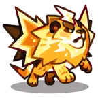

# Família Zappur
[← Catálogo](../tataris.md)

**Elétrico · 4 formas cadastradas**

[Zappur · T1](#zappur) → [Electroar · T2](#electroar) → [Blitzmane · T3](#blitzmane) → [Stormlion · T4](#stormlion)

!!! info "Origem e revisão"
    Base da wiki.gg coletada em 09/10/2026 e preservada pelo Horde Drafter. As notas abaixo aplicam os patches fornecidos pelo mantenedor em 07/11/2026. Descrições traduzidas pela comunidade; nomes de habilidades e efeitos próprios foram preservados para facilitar a consulta no jogo. Valores de balanceamento não foram certificados para a temporada atual.

## Zappur · T1 {#zappur}

{ width=160 height=160 loading=lazy }

**Elemento:** Elétrico · **Função:** Suporte · **Raridade:** Rara

### Habilidade normal

Bolt Bap: Dispara uma onda direta que causa dano em área e aplica Repulsão.

Consultar descrição original em inglês

Bolt Bap: Fires a direct wave that deals AoE damage and inflicts Knockback.

### Horda: níveis da partida

Os níveis 3, 5 e 7 abaixo são melhorias durante a Horda, independentes do grau T1–T4.

- **Nível 3 — Static Shock:** Ao ser atacado, tem chance de aplicar Paralisia ao atacante.
- **Nível 5 — Arc Charge:** Os ataques têm chance de causar um arco extra de dano em área.
- **Nível 7 — Lightburst:** Emite uma onda de choque luminosa, causando dano em uma área grande com chance de aplicar Repulsão.

[Página de origem e histórico de autores](https://clashofcritters.wiki.gg/wiki/Zappur)

## Electroar · T2 {#electroar}

{ width=160 height=160 loading=lazy }

**Elemento:** Elétrico · **Função:** Suporte · **Raridade:** Rara

### Habilidade normal

Pulse Surge: Dispara uma onda em arco que causa dano em área e aplica Repulsão.

Consultar descrição original em inglês

Pulse Surge: Fires an arc wave that deals AoE damage and inflicts Knockback.

### Horda: níveis da partida

Os níveis 3, 5 e 7 abaixo são melhorias durante a Horda, independentes do grau T1–T4.

- **Nível 3 — Static Shock:** Ao ser atacado, tem chance de aplicar Paralisia ao atacante.
- **Nível 5 — Arc Charge:** Os ataques têm chance de causar um arco extra de dano em área.
- **Nível 7 — Lightburst:** Emite uma onda de choque luminosa, causando dano em uma área grande com chance de aplicar Repulsão.

[Página de origem e histórico de autores](https://clashofcritters.wiki.gg/wiki/Electroar)

## Blitzmane · T3 {#blitzmane}

{ width=160 height=160 loading=lazy }

**Elemento:** Elétrico · **Função:** Suporte · **Raridade:** Rara

### Habilidade normal

Thunder Roar: Dispara uma onda energizante que causa dano em área e aplica Repulsão. Concede Morale: DMG Boost aos aliados próximos.

Consultar descrição original em inglês

Thunder Roar: Fires an energizing wave that deals AoE damage and inflicts Knockback. Grants nearby allies Morale: DMG Boost.

### Horda: níveis da partida

Os níveis 3, 5 e 7 abaixo são melhorias durante a Horda, independentes do grau T1–T4.

- **Nível 3 — Static Shock:** Ao ser atacado, tem chance de aplicar Paralisia ao atacante.
- **Nível 5 — Arc Charge:** Os ataques têm chance de causar um arco extra de dano em área.
- **Nível 7 — Lightburst:** Emite uma onda de choque luminosa, causando dano em uma área grande com chance de aplicar Repulsão.

[Página de origem e histórico de autores](https://clashofcritters.wiki.gg/wiki/Blitzmane)

## Stormlion · T4 {#stormlion}

{ width=160 height=160 loading=lazy }

**Elemento:** Elétrico · **Função:** Suporte · **Raridade:** Rara

### Habilidade normal

Polar Wave: Dispara uma onda energizante que causa dano em área e aplica Repulsão. Concede Morale: DMG Boost aos aliados próximos. Stormlion possui Aura: Lightning enquanto está no campo.

Consultar descrição original em inglês

Polar Wave: Fires an energizing wave that deals AoE damage and inflicts Knockback. Grants nearby allies with Morale: DMG Boost. Stormlion carries Aura: Lightning whenever on the field.

### Horda: níveis da partida

Os níveis 3, 5 e 7 abaixo são melhorias durante a Horda, independentes do grau T1–T4.

- **Nível 3 — Static Shock:** Ao ser atacado, tem chance de aplicar Paralisia ao atacante.
- **Nível 5 — Arc Charge:** Os ataques têm chance de causar um arco extra de dano em área.
- **Nível 7 — Lightburst:** Emite uma onda de choque luminosa, causando dano em uma área grande com chance de aplicar Repulsão.

[Página de origem e histórico de autores](https://clashofcritters.wiki.gg/wiki/Stormlion)

## Evolução e provas

Os nomes e graus acima descrevem a linhagem. Custos e tarefas não constam desta base e precisam ser conferidos no jogo. O patch de 04/11 substitui provas “Fishing Contest ou Zobo Shooter” por “Fishing Contest ou Artifact Adventure”, e “Raft Race ou Fishing Contest” por “Raft Race ou Zobo Shooter”, com transferência proporcional do progresso. Não há lista de famílias afetadas no anúncio.

## Fontes e créditos

Dados e descrições: colaboradores da [Clash of Critters Wiki](https://clashofcritters.wiki.gg/wiki/Tatari), via [Horde Drafter de Jeremy Canlas / jacc6475](https://github.com/jeremycanlas/clash-of-critters-horde-planner/tree/ec83738f3790c306e6e04d8b0878bdf388bd26e8). Textos derivados da wiki sob [CC BY-SA 4.0](https://creativecommons.org/licenses/by-sa/4.0/), com reorganização, descrições e rótulos traduzidos e notas de atualização pela Clash of Critters BR. Artes e conteúdo do jogo pertencem aos respectivos titulares; não são abrangidos pela licença MIT do código.

[Patches, glossário, limitações e política de atualização](../patches-tataris.md).
