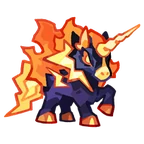

# Família Zapuni
[← Catálogo](../tataris.md)

**Elétrico · 4 formas cadastradas**

[Zapuni · T1](#zapuni) → [Surgehoof · T2](#surgehoof) → [Voltmare · T3](#voltmare) → [Boltallion · T4](#boltallion)

!!! info "Origem e revisão"
    Base da wiki.gg coletada em 09/10/2026 e preservada pelo Horde Drafter. As notas abaixo aplicam os patches fornecidos pelo mantenedor em 07/11/2026. Descrições traduzidas pela comunidade; nomes de habilidades e efeitos próprios foram preservados para facilitar a consulta no jogo. Valores de balanceamento não foram certificados para a temporada atual.

!!! note "Patch oficial fornecido"
    04/11: adicionadas sete aparências Sparkle à evolução T4 desta família.

## Zapuni · T1 {#zapuni}

{ width=160 height=160 loading=lazy }

**Elemento:** Elétrico · **Função:** Dano · **Raridade:** Rara

### Habilidade normal

Zap Wave: Dispara uma onda de choque que se espalha ao atingir o alvo.

Consultar descrição original em inglês

Zap Wave: Fires a shock wave that splashes on hit.

### Horda: níveis da partida

Os níveis 3, 5 e 7 abaixo são melhorias durante a Horda, independentes do grau T1–T4.

- **Nível 3 — Jolt Trigger:** Ao causar dano, tem chance de ativar um ataque elétrico adicional no alvo.
- **Nível 5 — Bolt Chain:** Invoca pequenas esferas elétricas para ativar continuamente raios em cadeia.
- **Nível 7 — Volt Horn:** Lança um chifre que atrai raios. Ao atingir o alvo, o chifre invoca raios continuamente naquela área, causando dano em uma área pequena.

[Página de origem e histórico de autores](https://clashofcritters.wiki.gg/wiki/Zapuni)

## Surgehoof · T2 {#surgehoof}

{ width=160 height=160 loading=lazy }

**Elemento:** Elétrico · **Função:** Dano · **Raridade:** Rara

### Habilidade normal

Surge Swell: Dispara uma onda de choque que se espalha ao atingir o alvo. A dispersão aumenta ao atingir um inimigo de Água.

Consultar descrição original em inglês

Surge Swell: Fires a shock wave that splashes on hit. Splashes increase when a Water enemy is hit.

### Horda: níveis da partida

Os níveis 3, 5 e 7 abaixo são melhorias durante a Horda, independentes do grau T1–T4.

- **Nível 3 — Jolt Trigger:** Ao causar dano, tem chance de ativar um ataque elétrico adicional no alvo.
- **Nível 5 — Bolt Chain:** Invoca pequenas esferas elétricas para ativar continuamente raios em cadeia.
- **Nível 7 — Volt Horn:** Lança um chifre que atrai raios. Ao atingir o alvo, o chifre invoca raios continuamente naquela área, causando dano em uma área pequena.

[Página de origem e histórico de autores](https://clashofcritters.wiki.gg/wiki/Surgehoof)

## Voltmare · T3 {#voltmare}

{ width=160 height=160 loading=lazy }

**Elemento:** Elétrico · **Função:** Dano · **Raridade:** Rara

### Habilidade normal

Volt Beam: Dispara uma onda de choque que causa dano adicional e se espalha ao atingir o alvo. A dispersão aumenta ao atingir um inimigo de Água. Quanto menos alvos forem atingidos pela dispersão, maior será o dano adicional.

Consultar descrição original em inglês

Volt Beam: Fires a shock wave that deals follow-up damage and splashes on hit. Splashes increase when a Water enemy is hit. The fewer targets hit by splashes, the higher the follow-up damage.

### Horda: níveis da partida

Os níveis 3, 5 e 7 abaixo são melhorias durante a Horda, independentes do grau T1–T4.

- **Nível 3 — Jolt Trigger:** Ao causar dano, tem chance de ativar um ataque elétrico adicional no alvo.
- **Nível 5 — Bolt Chain:** Invoca pequenas esferas elétricas para ativar continuamente raios em cadeia.
- **Nível 7 — Volt Horn:** Lança um chifre que atrai raios. Ao atingir o alvo, o chifre invoca raios continuamente naquela área, causando dano em uma área pequena.

[Página de origem e histórico de autores](https://clashofcritters.wiki.gg/wiki/Voltmare)

## Boltallion · T4 {#boltallion}

{ width=160 height=160 loading=lazy }

**Elemento:** Elétrico · **Função:** Dano · **Raridade:** Rara

### Habilidade normal

Tidal Shock: Dispara uma onda de choque que causa dano adicional e se espalha ao atingir o alvo. A dispersão aumenta ao atingir um inimigo de Água. Quanto menos alvos forem atingidos pela dispersão, maior será o dano adicional. Boltallion possui Aura: Lightning enquanto está no campo.

Consultar descrição original em inglês

Tidal Shock: Fires a shock wave that deals follow-up damage and splashes on hit. Splashes increase when a Water enemy is hit. The fewer targets hit by splashes, the higher the follow-up damage. Boltallion carries Aura: Lightning whenever on the field.

### Horda: níveis da partida

Os níveis 3, 5 e 7 abaixo são melhorias durante a Horda, independentes do grau T1–T4.

- **Nível 3 — Jolt Trigger:** Ao causar dano, tem chance de ativar um ataque elétrico adicional no alvo.
- **Nível 5 — Bolt Chain:** Invoca pequenas esferas elétricas para ativar continuamente raios em cadeia.
- **Nível 7 — Volt Horn:** Lança um chifre que atrai raios. Ao atingir o alvo, o chifre invoca raios continuamente naquela área, causando dano em uma área pequena.

[Página de origem e histórico de autores](https://clashofcritters.wiki.gg/wiki/Boltallion)

## Evolução e provas

A raridade indicada acima vem do campo Common/Rare da base. Ela é distinta do grau T1–T4 e das cores de evolução usadas em outros guias.

Os nomes e graus acima descrevem a linhagem. Custos e tarefas não constam desta base e precisam ser conferidos no jogo. O patch de 04/11 substitui provas “Fishing Contest ou Zobo Shooter” por “Fishing Contest ou Artifact Adventure”, e “Raft Race ou Fishing Contest” por “Raft Race ou Zobo Shooter”, com transferência proporcional do progresso. Não há lista de famílias afetadas no anúncio.

## Fontes e créditos

Dados e descrições: colaboradores da [Clash of Critters Wiki](https://clashofcritters.wiki.gg/wiki/Tatari), via [Horde Drafter de Jeremy Canlas / jacc6475](https://github.com/jeremycanlas/clash-of-critters-horde-planner/tree/ec83738f3790c306e6e04d8b0878bdf388bd26e8). Textos derivados da wiki sob [CC BY-SA 4.0](https://creativecommons.org/licenses/by-sa/4.0/), com reorganização, descrições e rótulos traduzidos e notas de atualização pela Clash of Critters BR. Artes e conteúdo do jogo pertencem aos respectivos titulares; não são abrangidos pela licença MIT do código.

[Patches, glossário, limitações e política de atualização](../patches-tataris.md).
